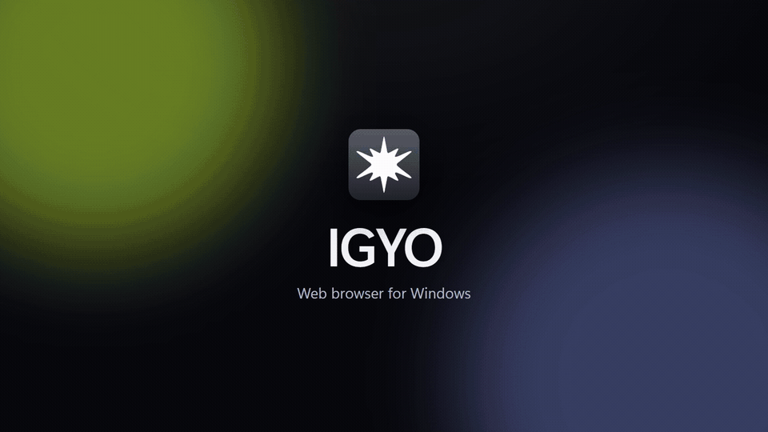
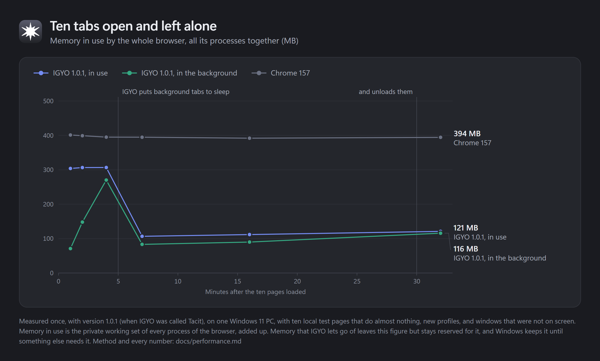
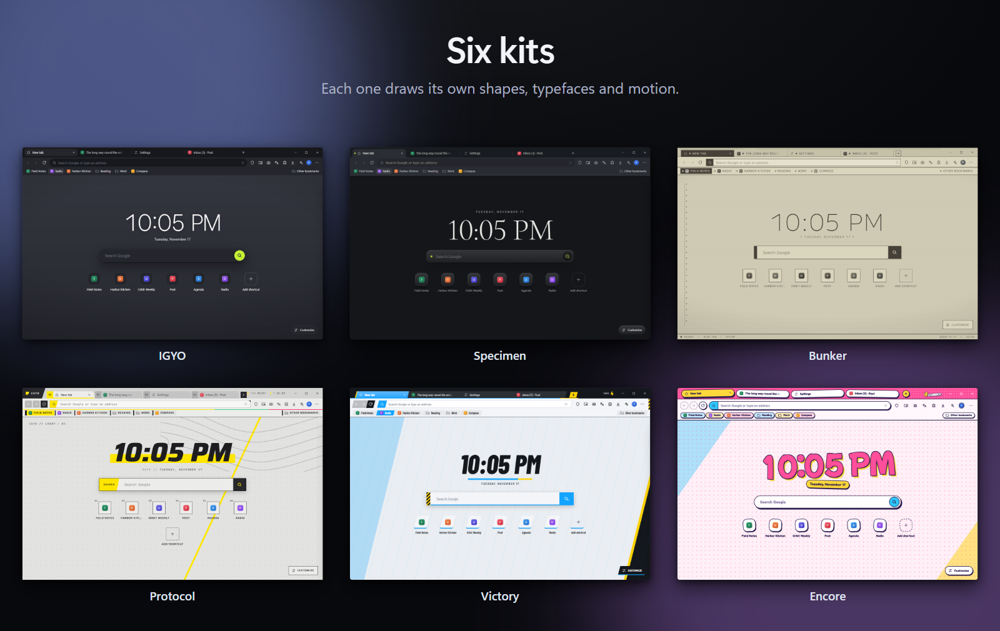
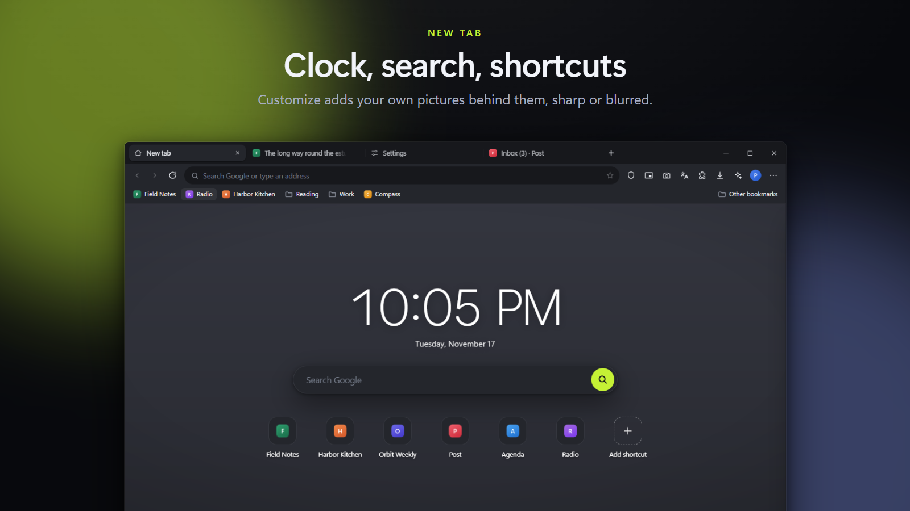
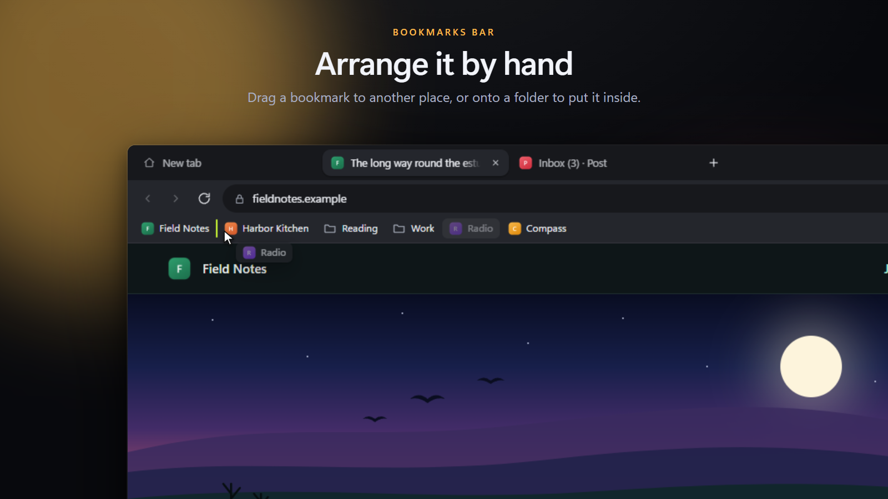
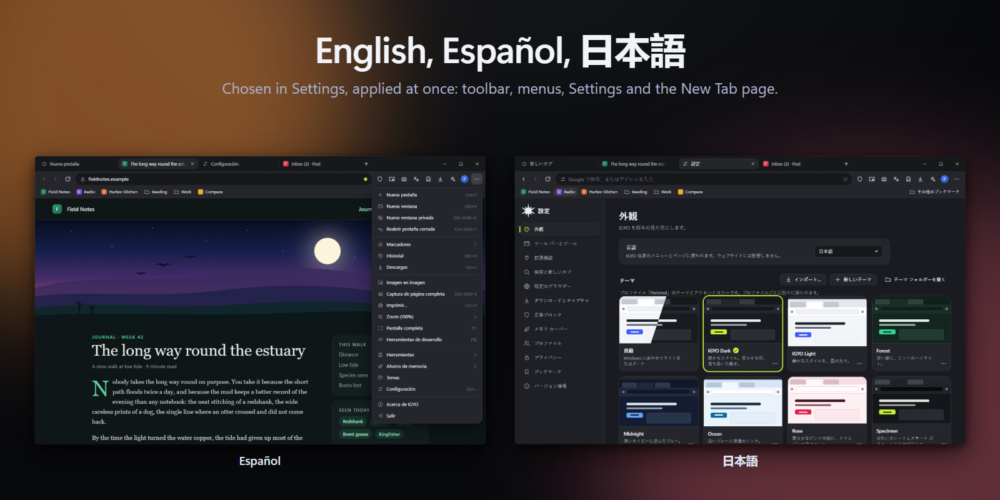
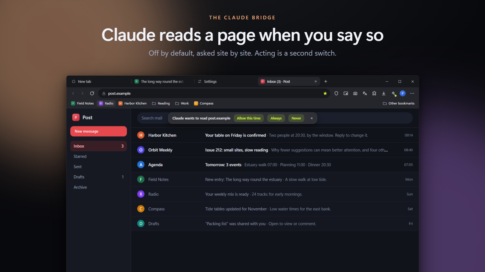
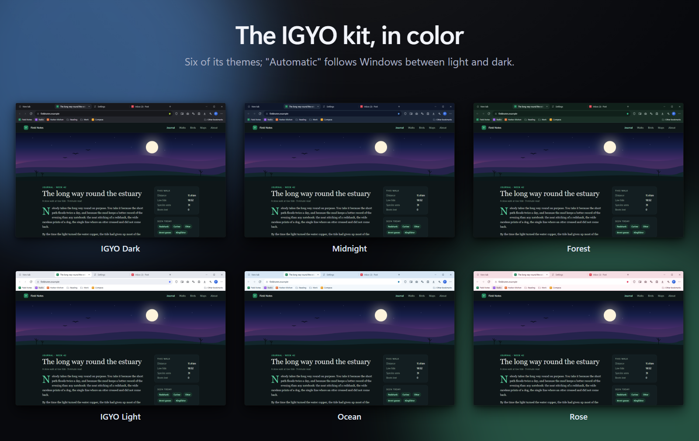
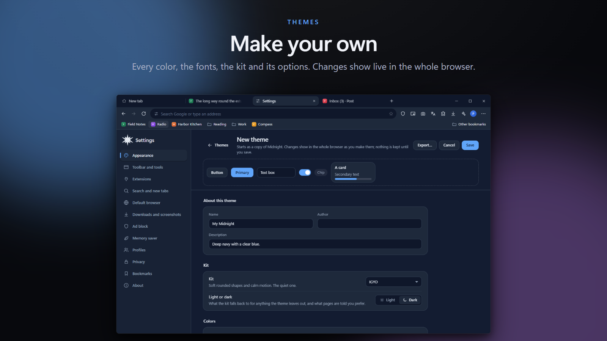

# IGYO

IGYO (異形, *igyō*: "strange-looking") is a web browser for Windows. It was called Tacit until November 2026:
installing IGYO over Tacit replaces it and keeps your profiles, bookmarks, sign-ins, settings and extensions.

<!-- lead:start -->
IGYO is built to stay light. Tabs you are not looking at let go of their memory, then sleep, then are unloaded;
switch to another program and all of IGYO lets go of what it is not using. With ten tabs open for seven
minutes, version 1.0.1 had 107 MB in use where Chrome had 395 MB
([how that was measured, and what it does not mean](#memory-and-performance)).
<!-- lead:end -->

It runs on Microsoft's Chromium-based WebView2 engine (the engine inside Microsoft Edge), shipped inside the
browser's own folder. It installs for your Windows user only, without admin rights, and changes nothing else
in Windows. Nothing is set to start with Windows, and nothing of IGYO keeps running after you close it.

**[Download the setup program](https://github.com/shinnahu/IGYO/releases/latest)** · Windows 10 or 11, 64-bit · about 283 MB, engine included

## A look

**Light on memory.** Tabs in the background let go of their memory, sleep after 5 minutes and are unloaded
after 30. Switch to another program and all of IGYO lets go of what it is not using.

**Looks that change more than colors.** Eleven themes on six kits, each kit with its own shapes, typefaces
and motion. Make your own in the theme editor.

**A New Tab page you set up yourself.** A clock, a search box and your shortcuts. Customize puts your own
pictures behind them, sharp or blurred, sets the clock's size, and has a button that goes straight to Themes.

**A bookmarks bar you arrange by hand.** Drag a bookmark anywhere: along the bar, onto a folder, into a folder's
list or out of it. Right-click to delete or to make a folder.

**English, Español, 日本語.** The whole interface, chosen in Settings and applied at once.

**Claude reads a page when you say so, and acts only where you let it.** Off by default, per profile, asked site
by site. Acting (its own tabs, clicks, typing, forms) is a second switch and a second question, and the window
shows it while it happens.

## Install

Run `IGYOSetup.exe` from [Releases](https://github.com/shinnahu/IGYO/releases/latest). It installs to
`%LOCALAPPDATA%\Programs\IGYO` (about 660 MB on disk, most of it the engine), adds desktop and Start menu
shortcuts and an entry in Settings > Apps > Installed apps, where you can uninstall it. The setup window is
in English, Spanish or Japanese, following Windows.

The setup window asks for one color, from thirteen. The first, Sunset, is picked unless you choose another: it
starts IGYO in the Sunset theme with that theme's own colors, its pink is the circle color of your first
profile, and while it is picked, setup's own button, switches and progress bar wear the Sunset icon's tile
colors, mauve running left to right into peach. Any other color becomes IGYO's own accent, which every profile that has not chosen an
accent of its own takes, and so does the window that asks which profile to open; it is also the accent and the
circle color of your first profile. The window starts on Sunset also over an install that had another color
picked: an update left on it brings the Sunset look, and the earlier color can be picked again to keep that.

Silent install: `IGYOSetup.exe /S` (optional `/D=<folder>`, `/NOSHORTCUTS`, `/NOLAUNCH`).

To update, close IGYO and run the newer setup; profiles, bookmarks and settings are kept (they live
elsewhere, see below). Setup refuses while IGYO is open. It unpacks the new copy beside the installed one and
puts it in its place only when every file of the old one is free, so a run that cannot finish leaves the
installed copy as it was. If IGYO's engine is still running although IGYO is closed, setup waits a few
seconds for it and then ends it.

IGYO needs .NET Framework 4.8. The setup program is not code-signed; each release lists its SHA-256 so you
can check the file you downloaded.

The engine inside the setup is Microsoft's WebView2 Runtime, under Microsoft's licence terms, not IGYO's:
installing means accepting them, and the setup window links to them.

**Protected video.** The setup leaves out one part of Microsoft's package: Google's Widevine module, which
sites use to play protected video. The engine fetches that module by itself: in a test with a new profile it
had arrived about six minutes after the first start, and from then on pages were told Widevine was available,
also after closing and starting IGYO again. Until it has arrived, such video will not play.

Your data lives in `%LOCALAPPDATA%\IGYO` (settings, profiles, bookmarks, New Tab pictures, engine data).
Uninstalling asks whether to delete it too; unless you say yes, it is kept.

**Default browser.** Setup lists IGYO with Windows as a browser, for your Windows user only, so it appears
in Settings > Apps > Default apps. Windows lets no program make itself the default: IGYO's Settings >
Default browser says whether it is the default and has a button that opens IGYO's own page in Windows'
Default apps, where you choose it. Uninstalling takes IGYO off that list.

## What it has

| | |
|---|---|
| Memory | Lets go of memory that is not being used; background tabs sleep, then are unloaded. See Memory and performance below. |
| Tools | One button at the right of the toolbar holds what acts on the page: ad block, dark mode for websites, video enhancement, a color picker, page translation, the tab's volume, picture in picture and the full-page screenshot. Every tool's line in its menu ends in a pin: pinned, the tool also has a button of its own on the toolbar. Pinned tools are dragged along the toolbar to change their order, and a right click on one unpins it. Under the tools, the same menu lists the extensions, which are pinned the same way (see Extensions). Ad block, picture in picture, the screenshot and translate are pinned to begin with. The two tools that are switched on and off switch from the menu without closing it, and their toolbar buttons show whether they are on. The same list is under Tools in the main menu, and the pins are also in Settings > Toolbar and tools. |
| Dark mode for websites | Websites with a light look are shown dark, by the engine's automatic dark mode. Sites that have a dark look of their own use it, pages that are already dark stay as they are, and IGYO's own pages follow the theme. One switch for all tabs. |
| Volume | Each tab has its own volume, from silence to 600%, on a slider in Tools; 100% is the page's own volume. Below 100% it turns down every sound in the page, also in the frames inside it. Above 100% it amplifies the sound the page owns (as on most video sites); sound that a page plays from another site without that site's permission stays at 100% instead of falling silent. |
| Color picker | Tools > Pick a color from the page: a magnifier follows the mouse over the page, a click copies the color as `#RRGGBB`, and the notice offers it as `rgb()`. Esc leaves without picking. |
| Enhance videos | On by default, and switched at once, also for a video that is playing (in Tools, or with its own toolbar button): videos are sharpened as the engine draws them. Edges and fine detail get more contrast and flat areas are left alone ("contrast adaptive sharpening"), a little, medium (the default) or strongly (Settings > Toolbar and tools). It is a setting the engine has for each video (`msVideoProcessing`, which Microsoft has not documented), so it needs no particular graphics card; an engine without it is left alone. A video that is being sharpened is drawn by the engine itself. With enhancement off, a video goes through the graphics card's video path instead, where the engine asks the driver for video super resolution, as Chromium does; whether the driver then does anything is decided in the driver's own settings (NVIDIA: Super Resolution under RTX Video Enhancement). The enhancement model of Microsoft Edge itself could not be switched on in this engine. |
| Translate | Select text, right-click, **Translate selection**: the translation appears in a small panel beside the selection. The panel names both languages, and either can be changed from a short list in which the languages you used before come first; the long list of all languages is one line further, and the language to translate into is remembered. Japanese, Korean, Thai, Greek, Hebrew and Hindi are known by their letters before anything is sent, so they are not taken for another language. Text that is already in the language you translate into is not "translated" into itself: it goes into a second language, if you chose one (Settings > Toolbar and tools), and otherwise the panel says so. The selected text is sent to MyMemory (mymemory.translated.net), a public translation service that needs no account and allows 5,000 characters a day from one network address; nothing else is sent with it. **Translate this page**, in Tools and on the toolbar, opens the page through Google Translate's website: the page's address is sent to Google, which fetches the page itself and shows it translated. So it works for pages anyone can open, not for pages on your PC or behind a sign-in. On a page shown that way, the same button shows the original page again. (The engine cannot translate a page by itself in an app like this one.) |
| Search a selection | Select text, right-click, **Search Google for “…”**, as in Chrome: it searches with the search engine chosen in Settings (the line then names that one), in a new tab beside the one you are on. The line stands right under Copy; a long selection is shortened in the line, and searched whole. |
| Google Lens | Right-click a picture and choose **Search image with Google Lens**, as in Chrome: the picture goes to Google Lens, and Lens's page opens in a new tab beside the one you are on. What is sent is the picture as the page already has it, taken from the engine rather than downloaded again (so a picture behind a sign-in goes too), at most 1000 pixels on its long side (a larger one is made smaller first, as Chrome does). When the engine has no copy of it, the page reads it itself; when the page may not either (a picture from another site), Lens is given the picture's address and fetches it itself. Nothing is sent before the line is chosen. |
| Extensions | Off until there is one in the extensions folder (Settings > Extensions > Open folder): an unpacked extension's own folder, or a `.zip` or `.crx` file, which IGYO unpacks there. There are three ways to get one in. Put it there yourself. Or open the extension's page in the Chrome Web Store or in Microsoft Edge Add-ons and choose **Add the extension on this page** in the tools menu: IGYO asks, then downloads the extension's package from that store into the folder (choosing it again later takes the store's newer version). Or press the store's own Add button on that page: by itself the engine takes that press, shows a question of its own, and nothing comes of it, so IGYO answers the page's request instead, with the same question and the same download. Once the extension is there, the store's button reads Remove; by itself the engine answers that press with a question in its own words ("Remove … from Microsoft Edge?"), so IGYO answers it as well, with its own question and its own removal (below). IGYO never adds or updates an extension by itself. What is in the folder is loaded when IGYO starts, or at once when extensions are already in use; the very first one needs IGYO closed and started again, because the engine's extension support cannot be switched on while it runs. Each extension has a line in the tools menu, under "Extensions", with its own picture and a pin, and a button on the toolbar while it is pinned (a new one starts pinned). A click on the button or the line opens the extension's popup under it, as large as the popup's own page, and the popup is told that the tab under it is the current one. A right click opens the extension's menu: on and off, its options, where it may read and change pages, manage, unpin, show in folder, remove. Settings > Extensions has a card for each with what its manifest asks for. Removing one takes it out of the profile (and out of the profiles of the other windows that are open) and moves its files to the Recycle Bin; should the engine not let go of it while IGYO runs, it is switched off and taken out completely at the next start, and its files are not moved while the engine still runs it. Some extensions name a page to be opened when they are removed (a "why did you leave" page); the engine opens such a page in a browser window of its own, apart from IGYO, and that window would keep the engine running after IGYO is closed, so IGYO closes it as it appears and no such page is shown. An extension's own button for its options, in its popup, opens them as a tab. A package from a store keeps the id it has in the store (the key it was signed with is written into the unpacked copy, as a browser does when it installs one), because extensions ask for their own files by that id. An extension can read and change the pages you open: only add what you trust. Not used in private windows. What the engine does not give an app like this one, and IGYO therefore lacks: a click on an extension's button is not handed to the extension, so one that has no popup can only be shown its options; the click does not give the one-time permission for the tab that browsers give ("activeTab"), so an extension that asks for no websites of its own cannot act on the page; badges and pictures an extension changes while it runs are not shown; an extension that asks for its options page from its background, instead of from its popup, gets it in a window of the engine's own, which IGYO closes when it is closed itself. Recording a tab's sound or picture is refused by the engine without that click. Settings > Extensions can name one extension that may record instead: the engine is then started with that extension's id on its list of extensions it lets through, which lets it record any tab at any time and also lets it past the engine's other such lists; it holds from the next start of IGYO on. When an extension's popup asks to record and is refused, IGYO closes the popup (such a popup goes on as if it were listening) and asks whether that extension is to be the one; a yes closes IGYO and starts it again, with the tabs that were open. Only extensions in the current format (Manifest V3) were tried. The addresses the packages are downloaded from are the ones the stores' own browsers use; neither store documents them for other programs, so that way in may stop working. Against the real Chrome Web Store, the line in the tools menu and the store's own button were each tried once, with one extension (see [How it was tested](#how-it-was-tested)); Microsoft Edge Add-ons was never contacted. |
| Address bar | Addresses open, anything else is searched with the search engine you chose. The engine's own pages can be typed as well (`edge://history`); `edge://settings`, which the engine does not have in an app like this one, opens IGYO's Settings. |
| Google suggestions | On by default; Settings > Search and new tabs turns them off. Shows Google's predictions (searches and popular sites) under the address bar; your bookmarks and history don't show up there. What you type is sent to Google as you type, without your cookies; addresses, file paths and long pastes are never sent, and private windows never send anything. Up/Down to choose, Enter to go, Esc to close. |
| New Tab page | Clock, a search box, and shortcuts you can add, edit, remove with Undo and drag to reorder. Customize: your own pictures as the background (one, or a different one with every new tab) and how out of focus they are (Blur, in every look), show or hide the clock and shortcuts, the clock's size, and a Themes button that opens Settings at Themes. Private windows show it without changing anything. |
| Tabs and windows | The window has no Windows title bar: tabs sit at the top with the window's own buttons. Drag a tab to reorder it. Drag it out of the tab strip and it is a window of its own at once, which follows the mouse until you let go; over the tab strip of another window of the same profile it goes into that window instead, and Esc puts it back where it was. A window's only tab moves its window, and joins another window's strip the same way. With tabs kept between starts, the next start brings back the window closed last, together with the ones closed within a minute before it. Resting the mouse on a tab shows a card with its title, its site, a picture of the page (for a tab that is not on show) and the memory its page uses. Right-click a tab for Duplicate, Close others and more, middle-click to close. New window (Ctrl+N), reopen closed tab (Ctrl+Shift+T). A link or a bookmark opened with the middle mouse button, or with Ctrl held, opens in a new tab behind the one you are on (with Shift held as well, IGYO goes to it), and so does **Open image in new tab** in a picture's right-click menu; Settings > Search and new tabs can make IGYO go to such tabs at once. Started by a link from another program, IGYO reopens last time's tabs and opens the link as one more tab; while IGYO is open, the link goes to the open IGYO instead (see Default browser). With the window maximized, the mouse thrown against the screen's edge still reaches what stands there, as in other browsers. The pointer at the very top of the screen over a tab lights that tab up, and a press there acts on it (choose, drag, middle-click to close, right-click for its menu). A click at the far left of the toolbar presses Back, one at the far right opens the main menu. Menus work from the keyboard too (arrows, Enter, Esc; Alt+F opens the main menu). |
| Default browser | Setup lists IGYO with Windows as a browser for `http` and `https` links and for page files (`.htm`, `.html`, `.shtml`, `.xht`, `.xhtml`); the choice is made in Windows' own settings, which Settings > Default browser opens at IGYO's page. One IGYO runs for a data folder: a link another program opens while IGYO is open goes to it, as a new tab at the end of the window used last, which comes to the front, and IGYO started again without a link opens a new window there, as Ctrl+N does. If IGYO is closing at that moment, the new start waits for it to end and then starts by itself. Windows starts IGYO for a link as `IGYO.exe --single-argument <link>`: everything after that switch is the one address, so a link written to look like switches (`… --uninstall`) is only ever opened as an address. |
| Private window | Ctrl+Shift+N. Nothing is kept after you close it, and passwords are never saved. |
| Profiles | Each profile has its own sign-ins, cookies, history, passwords, bookmarks, tabs, New Tab page, and theme and accent color (Settings > Appearance in one of its windows; a profile that never chose an accent has IGYO's own, the color picked in setup), in its own window, with any picture you like as its picture, or a circle with its first letter in the color you choose. Adding a profile (from the profile menu, or Settings > Profiles) shows that circle beside the name, and a click on it shows the colors it can have; the color can be changed later in its ⋯ menu in Settings > Profiles. With more than one profile, IGYO asks at start which one to open (Esc closes the question, and IGYO with it). Settings > Profiles can turn the question off; a profile made the default in its ⋯ menu then opens straight away (without a default, the question stays). A link from another program, or a profile named on the command line, never waits for the question. |
| Google account | You can sign in to Google's websites in each profile. The engine normally tells sites it is "Microsoft Edge WebView2", and Google refuses sign-in from those, so by default IGYO presents itself as Microsoft Edge, the engine it runs on (Settings > Privacy). The profile menu shows whether the profile is signed in, read from the profile's own cookies on the PC; Google is asked nothing. Chrome's own browser sign-in and sync exist only in Google Chrome. |
| Bookmarks | Star button (Ctrl+D). A bookmarks bar with folders and site icons. A bookmark or folder is dragged as a see-through copy that follows the mouse while the bar stays still: a line shows where it would go, a folder lights up when it would go inside, and a folder held under it for a moment opens, so it can be let go at a place inside (or inside a folder of it). Bookmarks are dragged out of a folder's list the same way, onto the bar or into another folder. Right-click one to open, edit or delete it (with Undo) or to make a folder (in a folder's list, the list stays open behind that menu, as in Chrome); right-click a folder to open all of its bookmarks in new tabs; right-click the bar itself for a new folder. A manager in Settings (Ctrl+Shift+O), import from Google Chrome, import and export of the standard HTML bookmarks file. When the bookmarks file of a profile is changed by another program while IGYO runs, IGYO reads it again at once. |
| History | Ctrl+H, or History in the main menu, opens the pages you visited in a tab: a list, newest first, with a search box, a "Filter by date" button, and a button on each entry that deletes it; a click on an entry opens it. Both the record and the page are the engine's own (`edge://history`). The engine keeps the record for each profile whether or not the page is ever opened, and IGYO keeps none beside it. So the page is in the engine's words and look, not in IGYO's languages and themes; it also lists IGYO's own New Tab and Settings pages; and its "Recently closed" list stays empty (Ctrl+Shift+T reopens a closed tab). Its "Delete browsing data" button leads to Settings > Privacy, where browsing data is cleared; its "Export browsing data" button has Windows ask who is at the PC before anything is exported. A private window leaves nothing in the record, and Ctrl+H there shows History in the profile's own window. |
| Languages | English, Spanish and Japanese; see Languages below. |
| Claude | A Claude app on the same PC can read pages you allow, add bookmarks, and, where you also allow it, act in its own tabs; see The Claude bridge below. Off by default. |
| Downloads | The engine's download panel (Ctrl+J). Folder: Settings > Downloads and screenshots. |
| Developer tools | F12, Ctrl+Shift+I, or right-click > Inspect. They open docked under the page, one per tab; buttons on the drawer dock them to the right, pop them out into their own window, or close them. |
| Ad block | Blocks requests to the ad servers in EasyList (bundled; Settings > Ad block > Update now). The page you open is never blocked. Element-hiding rules are not used. |
| Picture in picture | Pops the page's video into a floating window; press again to bring it back. The tab stays awake while its video floats. |
| Full-page screenshot | Ctrl+Shift+S saves the whole page as a PNG (Pictures\IGYO). |
| Print, zoom, full screen | Print: Ctrl+P. Zoom: Ctrl + / Ctrl − / Ctrl+0, Ctrl with the mouse wheel, or Menu > Zoom. While a page is not at 100%, a magnifier in the address bar says so (with a + above 100%, a − below) and opens a small box with the figure, − and +, and Reset. The box also comes up by itself when the zoom changes, and goes about two seconds after the last change. A zoom set with the keys, the menu or the box stays with the tab, also when it goes to another site. Full screen: F11; in full screen, the pointer at the very top of the screen brings down a round ✕ that leaves it, as in Chrome (also for a page's own full screen, such as a video's). |
| Customizing | Settings (Ctrl+,) is a page in a tab: themes, the app icon, toolbar buttons and tools, compact mode, bookmarks bar, search engine (Google, DuckDuckGo, Bing, Brave, Ecosia, Startpage or your own), New Tab page on or off, reopen tabs, folders, profiles, privacy, the bookmark manager. |
| App icon | Settings > Appearance > App icon offers twelve icons: IGYO's star on tiles of different colors (Sunset, mauve running down to peach, unless another is chosen). The one chosen is IGYO's icon at once, in its windows (Alt+Tab, the window's picture on the taskbar) and on its shortcuts: the desktop and Start menu shortcuts setup made, and IGYO's pins on the taskbar. Only shortcuts that start this IGYO are changed, and nothing of them but the icon. One icon for all profiles. When an update makes the shortcuts again, the next start puts the chosen icon back on them. |
| If something goes wrong | Unexpected errors are written to `errors.log` in the data folder and IGYO keeps going, with a small notice that links to the file. |

## Themes

A theme is one file: colors, fonts, corner roundness and border width, a few options and effects, and the
name of a **kit**. The kit is what makes themes look unlike each other: it draws the shapes, the decorations
and the animations. The six kits are IGYO, Specimen, Bunker, Protocol, Victory and Encore, and the IGYO kit
has seven color themes (IGYO Dark, IGYO Light, Midnight, Forest, Ocean, Rose and Sunset: IGYO Dark's greys
with a gold-to-pink glow on the active tab, under the toolbar, in the loading line, switches and buttons, an
amber star for a page that is a bookmark, and on New Tab the Sunset icon's tile, mauve running down to peach,
behind a white clock and a gold-to-pink search button). A new profile starts on
Automatic, which follows Windows between IGYO Dark and IGYO Light. Menu > Themes opens the gallery, and so does
the Themes button in the New Tab page's Customize.

**Your own themes** (Settings > Appearance): "New theme", or "Customize a copy" on any theme, opens the
editor: name, kit, light or dark, every color, fonts, roundness, border width, the kit's options, effects
(how new tabs appear, the loading line, click bursts, title and notice text effects), a New Tab background
picture and extra CSS. Changes show live in the whole browser and are kept only when you save. Built-in
themes are never changed. Export writes a `.json` file; Import reads one. Your themes live in
`%LOCALAPPDATA%\IGYO\Themes`. Settings > Appearance > Animations turns all motion off.

A theme file from someone else is safe to import: only known kinds of values are kept, the kit must be one of
IGYO's own, and CSS in it cannot load anything from the internet or run scripts.

**Fonts.** Five kits have their own typefaces; the IGYO kit uses the fonts Windows already has, apart from
the New Tab clock of IGYO Dark, IGYO Light and Sunset (Google Sans Flex). The ten families come with IGYO as 30 font
files (0.7 MB) in `Assets\Shared\fonts`. They are never installed in
Windows: only IGYO's own pages load them. Each family is under the SIL Open Font License 1.1, with its
licence text beside the files.

## Languages

IGYO's interface comes in **English, Spanish and Japanese**. Settings > Appearance > Language offers "Same
as Windows" (the default) and each language under its own name; the choice applies at once, without a
restart, to the toolbar, the menus, Settings and the New Tab page.

A language is one file, `Assets\Lang\<id>.json`, that maps each English text to its translation; a text
without a translation is shown in English. To add one, copy `es.json`, translate the values, and name the
file after the language (`ko.json`, `zh.json`…): it appears in the list by itself. `node tools\lang.js
check` says which texts a file is missing or no longer needs.

Websites are not told this choice. With Google suggestions on, the request for predictions does carry it,
as the language Google is asked to answer in.

## The Claude bridge

With **Settings > Privacy > Claude > "Let Claude use this profile"** switched on, a Claude app on the same
PC (Claude Code first) can list the profile's tabs and read pages in them: text, outline, find, and a
picture of the tab on show; it can also list the profile's bookmark folders and add a bookmark to one.
With **"Let Claude act in this profile"** switched on as well, it can open tabs of its own there and, on
the sites you allow for acting, go to addresses, click, type, scroll, drag, fill in forms, run scripts,
read the console and the network requests, and record what it does as a GIF.

- Off by default, per profile, never in a private window.
- The first time a program connects, IGYO names it and asks. The first time a site is wanted, IGYO asks
  again: Allow this time, Always, or Never. Acting on a site is asked about apart from reading it.
- Mouse and keys go to the page through the engine, never through the PC's own mouse and keyboard, and the
  window is not brought forward: you can keep working in another window. While Claude acts in a window, a
  sign in the bottom left corner of its page says so, with a button that stops Claude at once; the tabs
  Claude opened are marked. That sign and IGYO's questions for Claude are left out of screen recordings and
  screenshots (Windows 10 2004 or later): they are for the person at the PC.
- Claude closes only its own tabs, never a window, and never types into password, card-number or
  one-time-code boxes. Giving a page a file or a picture is asked about every time.
- A mark on the toolbar shows when the switch is on; its menu pauses everything at once.
- Password, card-number and one-time-code boxes are never returned, and are covered in pictures.
- What Claude reads leaves the PC: it becomes part of that conversation with Anthropic's service.

No port is opened: the Claude app starts `IGYO.exe --mcp`, which talks to the running browser over a
Windows pipe that only your Windows user can open. How it works, what it never does and what it cannot
protect you from are in [docs/claude-bridge.md](docs/claude-bridge.md).

## Memory and performance

<!-- performance:start -->
**What IGYO does about memory**

- **It lets go of what is not being used.** Half a minute after you leave a tab, the memory its page is not using
  is taken out of what Windows counts as in use by IGYO. A minute after you switch to another program, the same
  is done for all of IGYO, unless something is playing. And once, a few seconds after starting, for what only
  starting up needed. Nothing is paused: pages keep running, and whatever they need again comes back by itself,
  so a page that is awake takes much of it back within minutes and a sleeping one takes nothing back.
  Settings > Memory saver > "Give memory back to Windows" switches it off.
- A tab in the background goes to **sleep after 5 minutes**: the engine pauses it (timers, scripts, drawing). It
  keeps its page and wakes when you click it.
- After **30 minutes it is unloaded**: its memory is given up for good, the tab stays in the strip, and the page
  loads again when you click it.
- When the window is minimized, the tab on show sleeps too, after 30 seconds, and wakes when you restore it.
- A tab never sleeps and is never unloaded while it plays sound, floats a video or a window of its own in
  picture in picture, or is in a call: while its page holds the camera, the microphone or the screen, or plays a
  call's voices or pictures. IGYO asks the page before it puts a tab to sleep or unloads it, also the tab on show
  of a minimized window. Tabs reopened from last time load only when you click them.
- Sites can be kept awake for good, for pages IGYO can't tell are busy (a chat that should ring, a recording):
  Settings > Memory saver > "Never put these sites to sleep", or the menu's Memory saver for the site on show. A
  site covers the names under it (example.com covers chat.example.com).
- Settings > Memory saver changes both times (or sets them to Never) and shows the memory in use right now and the
  state of each tab, and why a tab in the background is kept awake.
- All tabs and windows share one engine. Its extension support only runs when the extensions folder holds
  something as IGYO starts; with an extension that keeps a background worker, one more process and about
  9 MB were measured (two runs each, 97 MB without and 106 MB with it, in a copy with one tab). Ad block
  refuses requests to ad servers before they are made.
- Nothing of IGYO runs while it is closed, and nothing is set to start with Windows.

**Measured against Chrome**, with version 1.0.1 (then called Tacit). Ten tabs were opened in each browser and
left alone. After 1 minute IGYO had
304 MB in use and Chrome 157 had 401 MB; after 7 minutes, with IGYO's background tabs asleep, 107 MB and
395 MB; after 32 minutes, with them unloaded, 121 MB and 394 MB. With one tab, after 5 minutes: 78 MB and
121 MB. Left in the background, IGYO had less still: 83 MB with ten tabs after 7 minutes.

**What those figures are, and are not.** "In use" is what Windows counts in each process's working set, the figure
Task Manager lists per process. Memory that IGYO lets go of leaves that figure, but it is not free: it stays
reserved for IGYO, and Windows keeps it until something else needs it. Measured on a PC with memory to spare:
when 453 MB were let go, the list of memory Windows has to save to disk before anything else can use it grew
by 457 MB, and available memory rose by 23 MB. Unloading is what gives memory up for good: after 32 minutes
IGYO's reserved memory was 305 MB, against Chrome's 603 MB.

This is one PC, one run, local test pages that do almost nothing, new profiles, and windows that were not on
screen. The method, every figure, and what Chrome does better (starting up, the memory it reserves while tabs
are loaded, and processor time while nothing is happening) are in [docs/performance.md](docs/performance.md);
the scripts are in `tools\bench`.
<!-- performance:end -->

**In Windows' Task Manager**, the engine's processes are listed in a group of their own, "WebView2 Manager",
apart from IGYO's own small process; the memory IGYO uses is the two together. For 1.0.9 two ways of having
them listed under IGYO were tried on Windows 11 (turning off the engine's reports to Task Manager, and keeping
the engine naming IGYO as their owner); neither changed the grouping, and neither is in the release.

## Privacy and security

**What IGYO's own code sends, and where.** Everything else is the engine loading the pages you open.

| When | Where | What |
|---|---|---|
| While you type in the address bar, if Google suggestions are on | `www.google.com/complete/search` | The words typed so far and the interface language. No cookies. Never from a private window; never addresses, file paths or long pastes. |
| When you press "Update now" in Settings > Ad block | `easylist.to` | A plain download of the current list. |
| When you use the Claude bridge | The Claude app on the same PC | The page content you allowed. It does not leave the PC through IGYO, but through that app. |

IGYO has no account, no sync, no telemetry and no update check of its own. Apart from opening the pages
you ask for, the program itself contacts a server in four cases: Google, with what you type in the address
bar, while suggestions are on; MyMemory, with a selection you ask it to translate; easylist.to, when you
update the ad block list; and Google's or Microsoft's extension store, with an extension's id and the
engine's version, when you choose to add the extension on the page you are on. (Translating a whole page
opens the page through Google Translate's website, which is given the page's address.) The engine is
Microsoft's and
connects to Microsoft by itself: with IGYO idle on local test pages, connections to four addresses
registered to Microsoft were seen ([docs/performance.md](docs/performance.md)). Microsoft SmartScreen is
switched on. The engine also downloads parts of its own by itself: after half an hour of running, its data
folder held about 60 MB of them (SmartScreen data, a filter list, certificate and key lists, hyphenation
data, speech recognition data and the Widevine module).

**Inside.** Pages get no access to the app. IGYO's own pages (its interface, New Tab, Settings) are loaded
from its folder and cannot be reached or read by websites; the interface cannot contact the network at all;
a theme's extra CSS cannot load anything from the internet. Browser extensions are switched off unless there
is one in the extensions folder: you put it there yourself, or you say yes when IGYO asks whether to add the
one on a store's page; nothing adds one without that. One that is there has the reach any browser extension
has, and the one named in Settings as the extension that may record tabs has more (see Extensions above). A
page at a web store's address is given a few lines of script by IGYO, which pass a press on the store's own
Add or Remove button on to IGYO; an extension's popup is given a few, which tell it which tab it was opened
over. No other page is given any for this. The engine itself tells a page at the Chrome Web Store's address
which extensions the profile has when the page asks (the real page asked as it loaded and after each press of
its button); IGYO leaves that as it is. The engine says that a page wants a new tab, not which mouse button
asked for it, so while an IGYO window is the active one IGYO has Windows tell it of mouse buttons as well
("raw input"); it keeps the moment the middle button was last used and nothing else, and asks for nothing
while no IGYO window is active or while Settings says to go to every new tab. The release build ignores
engine switches from the environment, such as a request to open a debugging port.

**The engine and its updates.** The engine is Microsoft Edge WebView2, Fixed Version 157.0.4341.57 (x64),
the version Microsoft released for Edge's Stable channel on 13 November 2026. A fixed-version engine does
not update itself: security fixes arrive only with a new IGYO release, or when you build one yourself with
a newer engine (below). If you install IGYO, keep it up to date.

**This release was checked** before publishing: the setup program and every file it unpacks were searched
for the user name, folders, network addresses and hardware ids of the PC that built them, and they contain
none; the unpacked files carry one fixed date instead of the time of the build; 43 of the 44 program files
carry a valid Microsoft signature, and the 44th is `IGYO.exe` itself, which is not signed; started once, the
installed copy opened no listening network port.

## Building

Needs the .NET SDK and the .NET Framework 4.8 targeting pack (both come with Visual Studio 2022), and the
engine, which is not in this repository:

1. Download the WebView2 Runtime, Fixed Version, x64, from
   https://developer.microsoft.com/microsoft-edge/webview2/ and expand it into `runtime\`:
   `expand <file>.cab -F:* runtime`
2. `powershell -ExecutionPolicy Bypass -File build.ps1`

The result is `dist\IGYOSetup.exe`, packed without the engine's Widevine folder, like the published setup.
`build.ps1 -KeepWidevine` keeps that folder and writes `dist\IGYOSetup-with-Widevine.exe`, for your own use.
To move to a newer engine, expand the newer package into `runtime\`, delete the old folder there and build
again; installing over an existing IGYO keeps profiles, bookmarks and settings.

Layout: `src\IGYO` (the browser; in `Assets`: `Ui` is the interface, `NewTab` the New Tab
page, `Settings` the Settings page, `Shared` the design system and fonts, `Themes` the themes and their
kits, `Lang` the languages), `src\Setup` (the setup program), `src\Shared`, `tools\` (`serve.js` shows the
pages without starting IGYO, `lang.js` checks the language files, `make-icon.ps1` draws an icon,
`make-app-icons.ps1` draws the app icons listed in `src\IGYO\Assets\AppIcons\icons.json` and the program's own
icon from the default one, `bench\` measures memory and start-up against Chrome), `docs\`.
Until the rename to IGYO the project and its namespace were called NoSuggestionsBrowser, the browser's first name.

`try-igyo.cmd` starts the Debug build on a separate data folder (`%LOCALAPPDATA%\IGYO trial`), beside an
installed IGYO and without touching its data. For checks, `NSB_DATA_DIR=<folder>` makes any build use that
data folder, and `IGYO.exe --selftest <report file>` runs the built-in checks in a throwaway folder.
`NSB_STARTUP_TRACE=<file>` makes any build write down, step by step, how long its start took.

### How the interface is built

- The browser's interface (tabs, toolbar, menus, dialogs, notices) is a page, `Assets\Ui\chrome.html`, drawn
  by the engine in one see-through view that lies over the whole window (`UiHost.cs`). The view's window
  region is only what the interface occupies at that moment, so everywhere else the mouse reaches the web
  page underneath. The page and the app talk by messages (`MainForm.Ui.cs`); the app owns the tabs and does
  the work.
- `Assets\Shared\base.css` is the design system (tokens and components) used by the interface, the New Tab
  page and Settings. `Assets\Themes\*.json` are the built-in themes, `Assets\Themes\kits\*.css` the kits,
  `kits\kits.json` what the theme editor offers. `Themes.cs` turns a theme into `/theme.css`.
- Settings is `Assets\Settings` served at `https://settings.igyo` by `SettingsPage.cs`; the New Tab page is
  `Assets\NewTab` served at `https://newtab.igyo` by `NewTabPage.cs`. Neither address exists on the
  internet.
- Working on the pages without starting IGYO: `node tools\serve.js --root src\IGYO\Assets\Ui`
  then open `http://localhost:5310/chrome.html?theme=bunker` in any Chromium browser (a stand-in for the app
  answers the page; files named `dev*` are never shipped).

## How it was tested

**1.0.10.** What changed since 1.0.9 was checked like this; the checks made for earlier versions follow, and
were not all repeated.

- **Built-in checks.** `IGYO.exe --selftest`, 294 checks, in the Debug build. New among them: setup's Sunset pick
  (the theme becomes IGYO's own and the first profile's, with its own accent and its pink for the circle; a
  theme this IGYO doesn't have is taken as a color only); the app icons with
  Sunset's new tile the default and Periwinkle still one to choose; Sunset's 32-pixel picture with its star in
  the middle and its tile's color at the side; the sites kept awake (what typed text becomes a site, which
  addresses a site covers, the list put right when read).
- **App icons.** Drawn again by `make-app-icons.ps1`: the eleven icons kept came out byte for byte the same.
  Sunset's 128-pixel picture down its left edge matches its colors within one step in each channel.
- **The setup window**, drawn into pictures from a build of setup without its payload: Sunset in its header,
  Sunset first in the color list and picked, the Sunset icon's tile colors spread evenly from left to right on
  the button, the switches, the color's dot and the progress bar, and the button's words bold and white.
- **The setup program**, built with `build.ps1` and installed silently into a test folder under test registry keys,
  28 checks: Tacit 1.0.6 replaced as before (setup refuses while it runs, then swaps it out), with the Sunset pick;
  the program file as built (1.0.10, as its entry says), the engine whole (253 files, no Widevine), the twelve app icons with Sunset the
  default, the Sunset theme; the program's and the setup's own icon equal Sunset's 32-pixel picture; the install
  marker carries the pick; the installed copy passes its built-in checks (294); started, it took the pick (IGYO and
  the first profile in the Sunset theme with its own accent, a pink circle) and gave the shortcuts the app icon
  chosen before; uninstalling left nothing. IGYO 1.0.9 as published, with Periwinkle picked, made setup refuse
  while it was open and was replaced at once after it was ended, its engine still running; it started again on
  its data and kept the look picked before. The built setup's window starts on Sunset, also over an install that
  had Periwinkle picked, its button mauve at the left and peach at the right.
- **The running browser**, the Debug build on the engine IGYO ships (157) with a throwaway data folder, on a
  Windows desktop that is never shown, driven through the engine's debugging protocol, with the engine's
  stand-in camera and microphone, local test pages and sleep after 6 seconds, unload after 30 (and 5 seconds
  when minimized), 23 checks, 22 passed:
  - in the background, a plain page and a page that took the microphone and let it go slept and were unloaded;
    a page holding the camera and microphone without showing them, a page playing another connection's stream
    (a call made inside the page), a page floating a video, a page floating a window of its own, and a page on
    a site of the list stayed awake; once each call ended and each floating window was closed, those tabs
    slept;
  - minimized, the tab on show stayed awake during its call and slept once the call had ended;
  - Settings > Memory saver named why each tab was awake; a whole address typed into the list was kept as its
    site, text that is no site was refused, Remove took a site off, and the list was saved; the menu's Memory
    saver named the site on show, and the site of the list that covers it;
  - one check failed, on the test's own expectation: the page floating a video also played a running stream,
    so Settings named it "In a call", which IGYO says before "Picture in picture".
  Not tried: a real camera, microphone or screen (screen sharing was not started at all), and Google Meet,
  Microsoft Teams or any other real call site.
- **The Settings page** on the development server: the twelve icons in rows of six, Sunset worn.
- **The Sunset theme.** The built-in checks find its text readable and its kit in place. On the
  development server: the interface (tab strip, toolbar, menu, a dialog's main button, the loading line), New
  Tab and Settings (switches, the section marker, the theme's card). In the Debug build on a throwaway data
  folder, 7 checks: the top bar has IGYO Dark's own greys, the line under the toolbar and the active tab's
  outline run from #FFC355 to #FF7596, and New Tab's ground is the Sunset icon's tile gradient (its colors at
  its places, the tile's sharp step between its two pinks blended over a tenth of the height) with a white
  clock and a search button running from #FFC355 to #FF7596 at 45 degrees.

**1.0.9.** What changed since 1.0.8 was checked like this; the checks made for earlier versions follow, and
were not all repeated.

- **Built-in checks.** `IGYO.exe --selftest`, 288 checks: the copy installed by this release's setup passes
  them. New among them: the app icons' list and files; each icon as a window gets it, with its star in the
  middle and its tile's color at the side; a shortcut that starts IGYO taking the icon chosen (once), a
  shortcut of another program left alone, and the default icon putting the program's own back; how the engine
  is started; a selection as the search line shows it (short ones whole, long ones cut between words).
- **The setup program**, 22 checks, installed silently into a test folder under test registry keys: Tacit 1.0.6
  replaced as for 1.0.7 (below); IGYO 1.0.7, installed from its published setup and started, made setup refuse
  while it was open, and, run at once after it had been ended, with its engine processes still running, setup
  installed 1.0.9 over it. Each time: the program file as built, the engine whole (253 files, no Widevine) and
  the twelve app icons; the program's and the setup's own icon equal Periwinkle's 32-pixel picture. Started
  with an app icon chosen before (Rose), the installed copy gave it to the desktop and Start menu shortcuts its
  setup had made, a few seconds after starting. Uninstalling left nothing.
- **The running browser**, the Debug build on a throwaway data folder, on a Windows desktop that is never
  shown, driven through the engine's debugging protocol:
  - the app icon, 18 checks: Settings > Appearance shows the twelve icons with their pictures, Periwinkle
    worn; a click on Rose gives the window Rose's icons, big and small (as Windows hands them out), and a test
    taskbar pin that starts this IGYO shows Rose, while a pin of another program is left as it was; Periwinkle
    again puts the program's own icon back on the pin; with Teal chosen, IGYO closed the ordinary way and left
    nothing running; the pin made again without the icon (as an update's setup makes its shortcuts) showed
    Teal a few seconds after the next start, and the window wore Teal from the start. The test pins were
    shortcut files in the test folder: the taskbar's own pins were never touched.
  - searching a selection, 6 checks: the line stands right under Copy, before "Translate selection"
    ("Search Google for “Microsoft's”"); taken as pressed, it opens a new tab right after the page, on show, at
    Google's search address for the selection; with DuckDuckGo chosen the line names DuckDuckGo, and a long
    selection is cut between words in the line while all of it is searched; in Spanish, two lines are joined
    into one and an ampersand is written the way the engine's own lines mark a plain "&". No search site was
    opened: the address of the search was checked.
- **The Settings page**: in the Debug build, the twelve icons in rows of six, the one worn ringed and named as
  the row's title; on the development server, in IGYO Dark (where a click wore the icon clicked) and IGYO Light.

**1.0.8.** What changed since 1.0.7 was checked like this; the checks made for earlier versions follow, and
were not all repeated.

- **Built-in checks.** `IGYO.exe --selftest`, 283 checks: the copy installed by this release's setup passes them.
- **The setup program**, 20 checks, installed silently into a test folder under test registry keys: Tacit 1.0.6
  replaced as for 1.0.7 (below); then IGYO 1.0.7, installed from its published setup and started, made setup
  refuse while it was open, and, run at once after it had been ended, with five of its engine processes still
  running, setup installed 1.0.8 over it: the program file as built, the engine whole (253 files, no Widevine),
  an Installed apps entry saying 1.0.8. That copy started again on the data the old one had left, and
  uninstalled cleanly.
- **The running browser**, the Debug build on a throwaway data folder, on a Windows desktop that is never
  shown, driven through the engine's debugging protocol (52 checks, plus 38 for Google Lens):
  - Claude's sign in the page's corner, with the Claude app's part played by the test build: shown while Claude
    acts, saying only "Claude is working in this window." with Stop, 16 pixels in from the page's bottom left
    corner, in Spanish with its accents; a question stacked above it, with its buttons, its explanation under
    the pointer, a press in its first 600 ms not counted, and its ✕; a notice about Claude and its button;
    hidden while the window is minimized and back with it; Stop cutting Claude off; the window never made the
    active one by any of it; and Windows reporting the sign's window as left out of screen pictures (the
    setting read back from Windows).
  - a bookmark's right-click menu over its folder's list: the list stays open; Esc, or a click on the list,
    closes only the right-click menu (and opens nothing); a click anywhere else closes both; a right click on
    another line of the list opens that line's menu instead; a choice in it acts on the right bookmark.
  - tabs lit by the pointer at the very top of the screen while maximized, in seven looks (IGYO Dark, IGYO
    Light, Specimen, Bunker, Protocol, Victory, Encore), without the tab strip becoming scrollable; a press
    there still selects the tab; nothing reaches out in a window that is not maximized.
  - full screen's ✕: it comes down when the pointer reaches the very top, stays while the pointer is near it,
    goes once the pointer is well below it, and a click on it leaves full screen (the pointer's place was given
    by the test build, standing in for Windows').
  - "Search image with Google Lens", against a stand-in on the same PC that took Lens's place (Google was never
    contacted): the line stands right after the engine's own lines about the picture; a new tab opens right
    after the page, on show, and asks Lens's upload address the way Chrome does (a form with the picture in
    it); a 1600 × 1200 JPEG went as 1000 × 750; a small PNG, a picture served only with the page's cookie
    (taken from the engine, and not asked for again), a picture written into its address (`data:`), one the
    page made (`blob:`) and an SVG went byte for byte; with the engine's copy taken away on purpose, the page
    read its own pictures, and for another site's picture Lens was given its address.

**1.0.7**, the first release under the name IGYO. What changed since 1.0.6 (released as Tacit) was checked
like this; the checks made for earlier versions follow, and were not all repeated.

- **Built-in checks.** `IGYO.exe --selftest` runs 283 checks in a throwaway data folder; the Debug build and
  the copy installed by this release's setup both pass them. New among them: what is brought over from the
  name Tacit (the data folder, tabs saved at the old addresses of IGYO's own pages, theme ids and theme files),
  themes and accent colors per profile, the colors offered, and the color picked in setup (taken once, as
  IGYO's own accent and the first profile's accent and circle; a later choice stays; setup run again with the
  same color leaves the first profile alone; a silent install changes nothing).
- **The setup program**, 20 checks, installed silently into a test folder under test registry keys. Tacit
  1.0.6, installed from its published setup and started: IGYO's setup refused, said to close Tacit first and
  changed nothing. With Tacit ended, it removed Tacit's folder, shortcuts, Installed apps entry and browser
  listing, and installed 1.0.7: the program file as built, the engine whole (253 files, no Widevine), an
  Installed apps entry saying 1.0.7. The installed copy passed the 283 checks. Started on a data folder with
  two profiles, the second used last, it took the color given to setup as IGYO's own accent and as the first
  profile's accent and circle color, and left the second profile's circle as it was. Uninstalling removed the
  folder, the entry, the browser listing and the shortcuts. Then IGYO 1.0.6 (a build of that version under the
  new name, never published) was installed the same way and started: setup refused while it was open, and,
  run at once after it had been ended, with six of its engine processes still running, installed 1.0.7 over
  it; that copy started again on the data the old one had left, and uninstalled cleanly.
- **Setup's color list.** The window's states were drawn into pictures by a test program that paints the
  window without showing it, in English, Spanish and Japanese. Run over a folder whose `install.json` names a
  color, the window starts on that color: 6 checks (Hot pink, the same written in small letters, Acid, none,
  one that is not offered, no install at all).
- **The running browser**, the Debug build on a throwaway data folder, on a Windows desktop that is never
  shown, driven through the engine's debugging protocol, as for the earlier versions below:
  - the window that asks which profile to open, with Periwinkle given to setup and the second profile used
    last: in the build before this release's fix its switch took the theme's own accent (acid); now it takes
    Periwinkle, also when that second profile has an accent of its own;
  - adding a profile and New Tab's Themes button, 14 checks: from the profile menu and from Settings >
    Profiles, the circle stands before the name, shows the name's first letter as it is typed, shows the 14
    colors with the current one marked when clicked, takes a picked color and closes the list, and the new
    profile is saved with that color; in New Tab's Customize, the Themes button closes Customize and opens
    Settings at Themes in a tab of the same window;
  - tabs dragged out of the strip, 48 checks with mouse input injected at the engine: the new window appears
    while the button is still down, with the tab exactly under the mouse, and follows the mouse; the tab goes
    into its own strip and along it, into the empty end of a strip, out again, into another window's strip,
    and back with Esc; nothing reloads; a window's only tab moves its window, into another window's strip and
    out again, and on letting go the old window is gone (that move was checked with a stand-in of the test
    build for Windows' own moving of a window). The card shown when resting on a tab was checked in the same
    runs (title, site, picture, memory);
  - themes per profile, with two profiles in one data folder: Midnight chosen in one profile's window changed
    only that profile, the other profile opened on IGYO Dark, and the first reopened on Midnight; switching
    themes four times in a row left one theme sheet, the last one chosen, in force (8 checks);
  - New Tab's Blur, 15 checks: Specimen with no picture, each look's default, 0, 25, 50 and 100, a WebP
    picture, a reload;
  - the identity the engine gives: on this release's engine, a page's service worker still named itself
    "Microsoft Edge WebView2" to sites while the page itself said Microsoft Edge; IGYO now gives workers and
    the frames of other sites the same identity as the page, and after the change the page, a worker and a
    service worker all said Microsoft Edge 157. (Reported with Gmail, whose top bar did not always load;
    Gmail itself was not opened in the checks.)
- **Memory of the Specimen look**, against IGYO Dark, three rounds each on the desktop that is never shown: an
  ordinary page on show 284.1 MB against 284.9 MB, the New Tab page 305.3 MB against 305.2 MB.

**Checks made for earlier versions.** Version 1.0.2 was released with its last two changes untried, and one of
them did not work: "Open image in new tab" never appeared in the menu. (For a picture, the engine says there is no address while handing the
address over, and IGYO went by the first.) 1.0.3 corrects that, and both changes were tried for it, as far
as a check can go: see "new tabs and History" below, and what is not tested at the end. 1.0.4's additions,
the zoom button with its box and the presses at the screen's edges, were tried the same way: see "the zoom
button and its box" and "the screen's edges" below. So were 1.0.5's, IGYO as a browser Windows can choose
and links handed to the open IGYO: see "Default browser" below. 1.0.6's (Claude acting, the profile
question at start, dragging bookmarks, taking extensions out) were tried the same way: see the lists below,
and what is not tested at the end.

- **Built-in checks.** `IGYO.exe --selftest` runs 254 checks in a throwaway data folder; the Debug build and
  the installed release copy both pass them. They cover what the address bar does with what is typed, which
  addresses count as a picture a tab can be opened at and as the engine's history and settings pages,
  bookmark import and export, ad block rules (including the bundled EasyList), settings (also settings saved
  by an earlier version, and ones edited by hand), how a text to translate is cut into pieces and what its
  letters say about its language, the addresses used for translating a page, what counts as an extension in
  the extensions folder and how a packed one is unpacked (one that names a file outside its own folder is
  refused), which addresses count as an extension's page in a store, what the extension is called when
  IGYO asks about it, and where its package is asked for, the requests a store's page makes to IGYO when
  its own Add or Remove button is pressed, which programs run from a folder (what setup and the uninstaller
  look for before they replace or remove IGYO's), the key in a store package's header and the ids
  the engine makes from a key and from a folder's path, what an extension's manifest says about it, the
  pins of extensions among the tools', what is and is not sent for
  suggestions, themes (every built-in theme loads and has
  readable contrast; a hostile theme file keeps only safe values), the fonts and their licence texts, the
  language files, the Claude bridge's rules and protocol, what Windows is told to run for a link and how a
  link it hands over stays one address (also one with quotation marks and switch-like words in it), the
  entries setup writes for Windows and their removal (under a throwaway registry key, leaving other programs'
  entries beside them alone), and what a copy hands to the open one.
- **The running browser.** The Debug build on a throwaway data folder, on a Windows desktop that is never
  shown, with pages served from the same PC and every other name lookup failing, driven by scripts through
  the engine's debugging protocol:
  - the Claude bridge, 125 checks for reading (listed in [docs/claude-bridge.md](docs/claude-bridge.md)),
    and 49 for acting with two profile windows open, one where Claude may act and one where it may only
    read, through a stand-in Claude app speaking MCP to the relay (also listed there);
  - extensions taken out after the window's first tab was closed (the case 1.0.5 failed at: the extension
    kept running in pages without its files), 10 checks, and the state 1.0.5 left behind, started again;
  - the profile question at start, 20 checks: asked with two profiles, the chosen one opens with its tabs,
    the default one opens without asking, a link handed over while the question is up, Esc;
  - dragging bookmarks, 22 checks with mouse input injected at the engine: along the bar, onto a folder,
    into a folder's list that opened under the mouse, out of a folder onto the bar, into and out of Other
    bookmarks, Esc, a folder over itself;
  - the bookmarks bar, 20 checks with mouse input injected at the engine: the right-click menus on a
    bookmark, on a folder, on the bar and inside a folder's list; delete and Undo; new folders; dragging to
    another place and into a folder; a plain click still opens;
  - the languages, 23 checks: Spanish and Japanese chosen in Settings while running; the toolbar, hints,
    menus, Settings and the New Tab page follow; back to English; an unknown language is refused;
  - new tabs and History, 61 checks, with clicks injected at the engine: a real right click on four pictures
    (one inside a link, one by itself, one whose address is the picture itself, one made in the page), with
    the engine's menu written down instead of shown: "Open image in new tab" stands right above the engine's
    own lines about the picture, and, taken as pressed, opens the picture in a tab behind the page, the four
    in the order they were opened, each showing a picture; links clicked with the middle button and with
    Ctrl held, whose tabs open behind the page in the order they were opened, also after going to another
    tab and back and after one of them was closed; a small window a page opens, a link that asks for a new
    tab itself and a page's own button, all gone to as before; bookmarks on the bar clicked with the middle
    button, with Ctrl and plainly; all of it again with the switch in Settings on; Ctrl+H and the menu line
    opening one History tab per window; the page listing what was visited, a click on an entry, an entry's
    delete button, the search box, "Delete browsing data" leading to Settings > Privacy, and the page's
    "Recently closed" list knowing nothing of a tab closed in IGYO; a website that asks for the engine's
    settings page getting neither a tab nor IGYO's Settings;
    `edge://history` and `edge://settings` typed into the address bar; Ctrl+H in a private window, with
    and without a window of the profile's own open, and the page visited privately missing from the list.
    An injected click is no click to Windows, so in these checks Windows told IGYO nothing of the mouse,
    and the test build was told to take the middle button as used. Windows telling IGYO of the middle
    button is the one step no check here reaches;
  - the screen's edges, 34 checks, in all six kits, with the window maximized and the presses injected at the
    engine. A press at the very top of the screen over a tab chooses that tab; in the Guild look (since removed), whose tabs
    run down the side, a press at the far left beside one does. A click at the far left of the toolbar goes
    back, and one at the far right opens the main menu. In the default look also: a right click at the very
    top opens the tab's menu, and a middle click closes the tab. A drag that starts at the very top takes the
    first tab to the last place and the last back to the first, and so does an ordinary drag; in 1.0.3 a
    dragged tab always stopped one place short of the end. In the default look's other style, whose tabs sit
    on the toolbar, a press at the very top chooses a tab as well. In a window that is not maximized, the
    same presses do nothing. With the zoom button in the
    same build, 7 more checks: the button showing at 110% and absent on a tab at 100% chosen by a press at the
    very top, back on the zoomed tab, its box opened by a click and its Reset bringing the page back to 100%;
  - the zoom button and its box, 27 checks, 25 of them passed. Ctrl +, Ctrl − and Ctrl+0 (given as pressed
    through the test build), the button and the box's own −, + and Reset all worked. The button shows only
    while the page is not at 100%, and the box comes up by itself on a change and goes about two seconds
    after the last one. The engine changing the zoom by itself, as it does for Ctrl with the mouse wheel,
    was imitated with a switch of the test build: with Ctrl held the box came up, without it only the button
    changed, and at a page load nothing came up. Two checks did not pass. A mouse wheel injected at the
    engine with Ctrl held did not zoom the page in this engine, so the wheel itself is untested. And a check
    that took for granted that a zoom follows the site found that it stays with the tab instead: another
    site opened in that tab keeps it, and other tabs of the same site keep theirs, as with the keys before;
  - the tools, 90 checks, with the engine's sound switched off and the clipboard left alone: the tools
    button and its menu (measured in all six kits and the three languages: it fits, no text is cut off and
    every pin stays inside its line); every line keeping its icon; the switches and pins working with the
    menu staying open; settings saved by an earlier version keeping the toolbar buttons it showed; pinning
    and unpinning from the menu, from Settings and by a right click; dragging pinned tools to another place
    with injected mouse input, and the order being kept; what each pinned button does and shows; dark mode
    for websites on a white page, on pages that are dark already, in a tab opened afterwards and in a tab
    that was asleep, with IGYO's own pages unchanged; the volume at 50%, 200%, 600% and 0% on the page's own
    sound, on sound from another site with and without that site's permission, in frames of the same and of
    another site, and after going to another page; the slider by mouse events and by keyboard; the color
    picker picking a known color through injected mouse input; video enhancement (below);
  - translating, 39 checks, with a stand-in on the same PC for the translation service, answering in the
    real service's shape and keeping what it was asked: a real right click on selected text (the engine's
    own menu was written down instead of shown, with "Translate selection" right under "Copy", and taken as
    pressed); exactly the selected text being sent, with Japanese named as the language before anything is
    sent; the panel's place under the selection, or above it at the bottom of the page; both lists of
    languages, the choice being remembered and offered first next time; text already in the wanted language,
    with and without a second language; a long selection being sent in pieces of at most 450 bytes that end
    with a sentence and come back in order; the service refusing or failing; Copy, the website link, the
    close button, Esc, and the panel going away with its page; for a whole page, which address is opened,
    the button turning into "Show the original page", and the way back to the page's own address. Through
    the app, the real service was asked three times: a Japanese sentence came back in English in 2.8
    seconds, an English one was reported as already in English, and three Chinese characters were
    translated with the service naming the language.
  - extensions, 145 checks, with three small extensions written for the purpose, with Animalese Typing
    1.45.3 from its `.zip`, and with BetterTTV 7.7.33 and Shazam 2.7.0 from their store packages: loaded
    from a folder, from a `.zip` and from a `.crx` dropped in while running; listed in the tools menu under
    their own heading, each with its picture and its pin; page script, style, storage and background worker
    working; a tab the extension asks for opening in IGYO; switched off and on, with pages opened
    afterwards following; its options page opening as a tab; still there after closing and starting again,
    and acting on the first page; taken out of the folder, gone; with the folder empty, the engine's
    extension support not running.
    Buttons and popups: a new extension getting its button on the toolbar, with its own picture, or a plug
    where it brings none; a click opening the popup in place, with no tab, as large as its page (320 by 180
    for the test one); what the popup asks about "the tab on show in this window", asked four ways, being
    answered with the tab under it; the popup closing on a second click, on a press elsewhere in the
    interface, on going to another tab and on its own `window.close()`, and a page it opens becoming a tab;
    its options page, asked for from the popup the way extensions ask, opening as a tab and not in a window
    of the engine's own;
    pinning and unpinning from the tools menu and from the right-click menu, and the order being kept after
    a move; the right-click menu on a button and on a line of the tools menu; Settings > Extensions with a
    card for each; switching one off from there; removing one after a question, with its folder, button,
    line, card and the profile's note of it gone and its script no longer run (the checks delete the folder
    where the release moves it to the Recycle Bin).
    Recording: asked for by a popup whose extension is not the one allowed, it is refused, the popup is
    closed, and IGYO asks whether this extension is to be the one. "Not now" changes nothing. "Allow and
    restart" closes IGYO and a new copy starts by itself, with the tab that was open (in settings that do
    not keep tabs between starts); the engine is started knowing the extension, and its popup is then given
    the sound of the tab under it: a tone of 880 Hz at a fifth of full level arrived as that, with the
    engine's sound output switched off altogether for this check (nothing reaches the speakers then, and a
    tab can still be recorded). Switched on in Settings instead, a notice offers the restart. The choice is
    also kept in a small file of the engine's own, which is believed when the settings name no extension. For the one
    named in Settings, after a restart: with the engine's sound left on for this one
    check and the tab playing a tone nobody hears (19 kHz at a five-hundredth of full level), the popup's
    recording carried that tone at that level. With the engine's sound muted, as in every other
    check, the same recording was silent.
    A data folder from the build before, in which that build had loaded BetterTTV under an id made from its
    folder's path: after one start BetterTTV was in the profile under its store id, with its key in its
    unpacked manifest, and Shazam, whose manifest has its key, was as it had been.
    With Animalese Typing, keys pressed in a page made it fetch and start the sound for each key (a letter,
    Enter, a digit, an arrow key, a capital letter, and its neutral sound in a password box), with the
    engine's sound switched off; its own popup, opened in place, switched it off and on.
    The store's own Add button, on a stand-in page served on the same PC at the store's address (the test
    engine was told to find the store's name there): the engine gives such a page the function a store
    installs with; a press on the button brought up IGYO's question; Cancel and Add were each passed back
    to the page; on Add the package was fetched and loaded and the extension had its button at once; the
    same request made another way, or by a page somewhere else, brought up nothing.
    Its Remove button, on the same stand-in page, calling what the real store's page was seen to call: a
    press brought up IGYO's own question about removing; Cancel reached the page as the refusal the engine
    gives a page when a person says no, both for a page that hands over a function to call back and for one
    that waits on a promise; Remove took the extension out as "Remove from IGYO" does, files and button
    gone, with the page told it went well; an extension that is not one of IGYO's was left to the engine's
    own function; the same request made another way brought up nothing.
    "Add the extension on this page",
    with a stand-in on the same PC for both stores' package addresses: offered only on a store's extension
    page; the question first, naming the extension by the name in the page's address, or by its id where
    the address has no name (a store's page cannot be opened in the checks, so the tab has only the site's
    name for a title), and nothing asked of the store on Cancel; exactly that extension's package
    asked for, once, at the store the page belongs to; kept in the folder under the extension's id; used
    from the next start when the folder had been empty, and at once otherwise; a newer version taking the
    older one's place with the engine running the new files; the store having nothing to hand out, sending
    something that is no package, or sending another extension, each refused with nothing kept. And a
    second copy of IGYO started while the first was still open, after the first extension had arrived,
    after the extension that may record had been changed, and with nothing changed: in the first two cases
    it starts itself again the way the running engine was asked for, instead of ending up without a page
    (tried by hand, not counted above). The notice about a newly loaded extension was also checked with the
    interface made to load five seconds late (a switch of the test build): the notice waits, and is shown
    once the interface is ready.
  - BetterTTV on Twitch itself (one chat page, not signed in), in a test copy with a way out to the internet
    except to Google's names. Loaded by the build before, the two requests its page script made for its own
    files failed and the part of the page that holds its settings window stayed hidden. Loaded by this
    build, the request was answered, its stylesheet loaded, and after its "BetterTTV Settings" line was
    clicked and the page was made to draw frames (a window that is never shown draws none by itself), its
    settings window was in the page.
  - Shazam's own popup, in a test copy with no way out: opened in place at 420 by 251, it said "Listening",
    and the engine reported its recording of the tab under it as active; with nothing reachable and only an
    inaudible tone playing it then said it could not catch anything.
  - Shazam with a real song, in a test copy that could reach Shazam's and Apple's servers and nothing else,
    its sound output switched off altogether: the tab played Apple's 30-second preview of deadmau5's "Not
    Exactly". Started with no extension allowed to record: a click on Shazam's button opened its popup,
    IGYO closed it and asked, "Allow and restart" brought IGYO back two seconds later with the tab, and
    Shazam's popup then said "Listening" and, 4.5 seconds after it opened, "Not Exactly, deadmau5". Another
    part of that preview and the preview of another release of the song gave the same answer; the first
    seconds of the first preview gave another track. Without the permission, as IGYO was before this
    build, the popup went through "Listening", "Searching for a match", "Expanding search" and "This is a
    tough one" and then stayed empty, while nothing was recorded and nothing was asked of Shazam's servers.
  - the Chrome Web Store itself, once: "Add the extension on this page" for Animalese Typing, in a test
    copy whose tab could not open the store's page, so that only the request for the package left the PC.
    The package (3,195,263 bytes) was in the extensions folder within a second of "Add" being pressed, and
    its header carried the id that was asked for. After closing and starting again, IGYO had unpacked
    version 1.45.3 and listed it, its background worker was running, and a typed letter started its sound.
  - the Chrome Web Store's own page, once: the page of Animalese Typing, not signed in, in a test copy whose
    engine could reach Google's names and nothing else, open for about six minutes. It showed "Switch to
    Chrome to install extensions and themes" and an "Add to Chrome" button. A press on that button with the
    mouse (injected at the engine) made the page call the engine's install function with the extension's
    id, name and manifest, and within half a second IGYO's question was up, naming the extension as the
    page named it. Answered with Cancel, the page was told the person had said no and kept its button. Pressed again
    and answered with Add: the package (3,195,263 bytes) was fetched and loaded, the extension had its
    button on the toolbar and its background worker ran under its id in the store, and the page's button
    read "Remove from Chrome". Both times the request IGYO listens for was answered by IGYO, and the page
    reported no broken rule of its own about what it may load. (For the first press a recorder stood in
    front of the functions the engine gives the page; it was taken out before the second.) A press on
    "Remove from Chrome", in the build of that moment, which did not answer it yet: the page called the
    engine's uninstall function and the engine put up its own question, "Remove "Animalese Typing" from
    Microsoft Edge?"; with that closed, the page was told the person had cancelled and asked again how
    things stood. What this build does for that button was then tried on the same page by hand: with the
    page's call held back, a cancel worded as the engine words it was taken by the page exactly as the
    engine's own, and after "Remove from IGYO" the page showed "Add to Chrome" again.
  - the window the engine opens by itself, 25 checks, with a small extension that names a page (served on
    the same PC) to be opened when it is removed, and with the engine's processes counted after IGYO had
    closed. Removed from its menu: the page was not among the engine's pages 0.15, 0.4, 1 and 2.5 seconds
    later, one window of the engine's own had been closed as it appeared and nothing else, no tab was opened,
    the other extension's popup still opened, another extension was added and removed afterwards, and three
    seconds after IGYO was closed none of the engine's processes was running. With that window left alone
    (a switch of the test build): it was a shown window of the engine's own, 961 by 1032 pixels at the top
    left; closing IGYO closed it too and the engine ended. Left alone at the end as well, as builds before
    this one left it: the engine was still running five seconds after IGYO had closed, and the next start
    of IGYO closed the window. And in a profile as an earlier build of this version left it, with an
    extension from a store package in it under the id made from its folder's path: at the next start IGYO
    wrote the package's key into the manifest and took the old copy out, the engine opened that copy's
    goodbye page, the window was closed as it appeared, and the extension was there under its id in the
    store, its popup opening. Asked from an extension's background for a tab or for a window, the engine
    hands the page to IGYO, which opens a tab; asked for the extension's options page, it shows a window
    of its own (tried by hand, not counted).
- **Video enhancement.** Measured on pictures of one fixed video frame as the engine draws it (the mean step
  between neighbouring pixels, which grows as edges get sharper). A 640 by 360 test pattern shown at 960 by
  540: 1.00 with enhancement off, 1.17 a little, 1.25 medium, 1.43 strongly. A video made from a photo, at
  640 by 360 shown at 960 by 540: 1.96 off, 2.74, 3.08 and 4.00; the same at 960 by 540 shown at its own
  size: 3.86 off, 5.75, 6.62 and 8.99, where "strongly" already looks harsh. Switching was checked on a
  playing video, from the menu and from the toolbar button, in frames of the same and of another site, on a
  page opened afterwards and in a tab that was asleep; with it off, a page is given nothing at all. A video
  that is given its setting before it has begun to load reads the setting back but is drawn plain, so the
  setting is given again when loading starts (found by measuring the picture, not by reading the setting).
  The cost, at the strongest setting, with the window not on screen and other programs using the same card:
  card load 29% and 15.7 W on, 28% and 15.0 W off with the 360-line video; 27% and 15.6 W on, 32% and
  16.1 W off with a 1080-line one, each the mean of two runs; no difference that repeats. With it on, the
  engine reported 6 frames dropped in the first two seconds of the 360-line video and none in the 28 seconds
  after (900 frames in all); with it off, none. With enhancement off, the engine's own record
  showed it asking the graphics driver for super resolution on every frame; whether the driver then changed
  the picture could not be seen.
- **Letting go of memory.** Measured with the installed release copy
  ([docs/performance.md](docs/performance.md)). In the Debug build, coming back to a tab after its memory and
  then all of IGYO's had been let go: the tab was on show and its page answering 10 ms after it was chosen;
  reading through everything the page keeps took 8 ms the first time and 3 ms when asked again; the main
  menu opened in 22 ms the first time and in 4 ms the second.
- **Default browser and links from other programs.** The Debug build on a throwaway data folder, on the
  desktop that is never shown, 13 checks: a copy started with a link the way Windows starts one handed it to
  the open copy and ended within 0.1 s, and the link opened there; a link with quotation marks and
  `--uninstall --quiet --remove-data` in it opened as one address and nothing was uninstalled or deleted;
  three copies started at the same moment all handed their links over; started again without a link, the open
  copy opened a second window (counted on that desktop, where a second window's interface does not load, the
  same as with Ctrl+N); a link given the ordinary way was handed over too; a link sent while the open copy was
  still starting opened once its window was up; a copy started while the open one was closing waited, both
  running and the link not opened, and once that one had ended it started by itself with the link; IGYO
  restarting itself while a link came in left one copy with the earlier tab and the new link; and at the end
  nothing was left running. Settings > Default browser, 5 checks: in a copy that was not installed it says so,
  shows no button, and the app refuses; in a copy set up as installed (under a test registry key) it says IGYO
  is not the default and names the browser links go to now, and its button wrote Windows' entries back for
  that copy and asked for Windows' page for it (the test build writes down the address instead of opening it).
- **The setup program.** Installed silently into a test folder under a test registry key. The installed copy
  passed the 232 checks, ran on its own engine, opened no listening network port and left no `errors.log`.
  Asked to close its window the ordinary way, it ended by itself, had saved its tabs, and five seconds later
  nothing from its folder was running. Uninstalling removed the folder, the shortcuts and the registry key.
  Run again over that test install, 11 checks: over a closed copy it went through, with nothing of the old
  copy left inside its folders and a file of someone else's beside them untouched; with IGYO of that folder
  open it refused, said so and changed nothing; with an engine of that install still running although its
  IGYO was closed, it waited, ended the engine and installed in 7 seconds, and the copy passed its built-in
  checks; with a file of the engine held open by another program it gave up after 7 seconds, said what to
  do, and left the installed copy whole, which still passed its checks; uninstalling while an engine of the
  install was still running ended the engine and removed everything.
  Over a test install brought into the state the earlier setup had left one in (an engine of it running,
  every file of the engine that was not in use deleted), 5 checks: it ended the engine and installed in 7
  seconds, and the copy passed its built-in checks, started, and left nothing running when it was closed.
  And the installed copy on a profile as an earlier build of this version left it (an extension to be moved
  to its id in the store, naming a goodbye page), 6 checks: no window of the engine's own stayed on show,
  and four seconds after closing nothing of the install was running.
  The setup as it was before (also the one published with 1.0.1) deleted the old engine before unpacking,
  and looked only for IGYO itself, not for its engine. In the third situation, tried in the same test
  folder, it stopped with "Access to the path 'd3dcompiler_47.dll' is denied" after deleting 242 of the
  engine's 253 files.
  1.0.4's setup has the same code as 1.0.3's apart from its version number. For 1.0.4 itself: 1.0.3,
  installed from its published setup into a test folder, was started with a small extension in its profile
  and closed the ordinary way. 1.0.4's setup was run over it at once, with six of 1.0.3's engine processes
  still running as it started. It finished in 4 seconds, all 339 files were as built, and nothing of 1.0.3
  was left running. The new copy passed the 232 checks, started with the extension and, closed the ordinary
  way, left nothing running. Uninstalling removed the folder, the shortcuts and the registry key.
  For 1.0.5, the same way with 1.0.4's published setup, 20 checks: 1.0.4 wrote nothing for Windows as a
  browser; 1.0.5's setup, run over it at once with six of its engine processes still running, went through,
  the 339 files were as built, and the entries for Windows were there (the program listed with what it can
  open, and what Windows runs for a link). Windows' shell then listed it among the programs for `https` links
  and for `.html` files, and the default for links stayed what it was. The copy passed
  the 253 checks. Started the way Windows' entry starts it, with a link holding quotation marks and
  `--uninstall --quiet --remove-data`, it ran, nothing was uninstalled or deleted, and its saved tabs held
  that link as one address; a second link started the same way was handed to it in 0.1 s. Uninstalling
  removed the folder, the shortcuts, the registry key and every entry for Windows, and Windows' shell no
  longer listed it for `https` links.
  For 1.0.6, the same way with 1.0.5's published setup: started with an extension, closed the ordinary way,
  and 1.0.6's setup run over it at once with five of its engine processes still running. It went through,
  the 342 files were as built, the entries for Windows were there and listed by Windows' shell, the copy
  passed the 254 checks, the link with switch-like words stayed one address, a second link was handed over
  in 0.1 s, and uninstalling removed everything it had written. The default for links was the same before
  and after (one of the 20 checks expected the browser that had been the default when 1.0.5 was checked,
  and the default on that PC had changed since).

- **Earlier builds** were also checked for window behaviour (maximize, minimize, full screen), where the
  mouse and keyboard land between the interface and the page, tabs (new, choose, close, duplicate, move,
  restore), menus by keyboard, the theme editor, the bookmark manager, profiles, a private window, the ad
  block counter, the full-page screenshot, docked developer tools, and starting with saved tabs or from a
  link. Those checks were not repeated on this build.

**Not tested in 1.0.10:** a real call: Google Meet, Microsoft Teams or any other call site, a real camera or
microphone, and screen sharing (no screen was shared in the checks; what keeps a tab in a call awake was tried
with the engine's stand-in camera and microphone and a call made inside a local page, so whether a given call
site's page shows its call the ways IGYO looks for is not known from them); the Sunset theme and the setup
window on a real screen (the theme was read back from the running browser and drawn on the development
server; the setup window was drawn into pictures by a test program, not clicked).

**Not tested in 1.0.9:** a newly chosen icon on the real taskbar, Start menu and desktop (what was checked is
the windows' icons and the shortcut files, read back; whether Windows draws the change at once is not known
from that), and which icon the taskbar shows for an IGYO window that is not pinned; the icons on a display
scaled above 100%; the setup window on a real screen with the new icon (it was drawn into a picture by a
test program); pressing "Search … for" in the engine's own right-click menu (it was taken as pressed), and how
the engine draws an ampersand in that line.

**Not tested in 1.0.8:** a real screen recording or screenshot with Claude's sign up (no recorder was run;
what was checked is that Windows reports the sign's window as left out of screen pictures); Claude's sign with
the real mouse, and on a display scaled above 100%; the real mouse at the top of the screen (tabs lit, full
screen's ✕), and the ✕ for a page's own full screen, such as a video's; Google Lens itself (no picture was sent
to Google in the checks, so whether Lens takes the form as it is sent, and what it shows, is not known from
them); a picture inside a frame of the page, a WebP or AVIF picture, and pressing the Lens line in the
engine's own menu (it was taken as pressed).

**Not tested in 1.0.7:** dragging tabs out with the real mouse (the drags were injected at the engine, and a
window's only tab was moved with a stand-in for Windows' own window move), a drag whose mouse capture is lost
half way, Windows snapping a window while its only tab is dragged; the setup window on a real screen, and a
real install through it with a color picked (the color was given to silent installs instead); whether Gmail's
top bar now loads every time (Gmail cannot be opened in the checks); two profiles' windows open at the same
time with different themes (a second window's interface does not load on the desktop that is never shown).

**Not tested in earlier versions, and still not:** what Windows tells IGYO of the real mouse's middle button, which is how a link opened with
it is told from one that was clicked (in the checks the test build was told to take the button as used), and
Ctrl held on the real keyboard; pressing "Open image in new tab" in the engine's own menu (it was taken as
pressed); History's "Filter by date"; its "Export browsing data" past the window in which Windows asks who is at the
PC (pressed once: that window came up, on the desktop that is never shown, and was left unanswered);
History with more than one profile, and in another language than English; the real mouse and keyboard (every click and key in the checks was injected), and so the presses at the screen's edges as Windows hands them over; the mouse wheel with Ctrl, which zooms the page (an injected wheel did not); the zoom box closing when the page or another window is clicked; a real site getting back, as it loads, a zoom it had before (Microsoft's documentation says the engine keeps the zoom made with the wheel for each site; not checked); a window that
is on screen (every running copy was on a desktop that is never shown, where pages are not drawn; this
includes every memory reading); a PC that is short of memory; the volume by ear (what was checked is the
volume each sound was set to and the amplifier it was played through); dark mode for websites, the volume,
the color picker and video enhancement on real websites (local test pages and local test videos only);
video enhancement by eye on a screen, on video protected against copying, on HDR video and in picture in
picture; translating a whole page (Google Translate's website was never opened: only which address IGYO
opens, and how it finds the way back, were checked); the translation service beyond three short texts, and
its daily limit being reached for real; pressing "Translate selection" in the engine's own right-click menu;
extensions by ear, any extension other than the ones named above, extensions in the older format
(Manifest V2); an extension's popup with the real mouse and keyboard, and its closing when another program
or the page is clicked (every running copy was on a desktop that is never shown, where nothing has the
keyboard); Shazam with sound that is heard (the song was played with the engine's sound output switched
off) and with any song but the one named above; BetterTTV's settings window in a window that is on screen, and
BetterTTV signed in; a removed extension's files arriving in the Recycle Bin; a web store's own buttons
beyond the one visit described above (one page of the Chrome Web Store, not signed in, one extension, the
presses injected; this build's answer to the Remove button was tried there by hand and, as built, only on a
stand-in page); what the engine does when its own "Remove" question is answered with yes; the own buttons of
Microsoft Edge Add-ons (its pages were never opened, so whether they ask the engine the same way is not
known); "Add the extension on this page"
against Microsoft Edge Add-ons (never contacted: its address is the one in common use) and against the
Chrome Web Store beyond the one download described above (not with the store's page open in the tab, not a
second extension, not a newer version of one that is already there), and what an extension does on websites
that could not be opened in the checks;
displays scaled above 100%; a second monitor;
Windows 10; picture in picture with a real video; real downloads; printing; Windows' file pickers; signing
in to a Google account and Google's live suggestions; a tool call from inside a real Claude conversation
(the checks play the Claude app's part); Claude picturing a window that another window covers on a real
screen (IGYO asks the engine to keep drawing covered windows while some profile lets Claude act; on the
desktop that is never shown, pictures worked either way, so the need for it is not shown); dragging
bookmarks with the real mouse (the checks inject mouse input at the engine);

the setup window's Spanish and Japanese texts and its "Read the terms" link; playing a video protected with
Widevine (only that the engine fetched the module and reported it available, checked with an earlier
build); installing over an IGYO that is in daily use (only over a test install in a test folder); the goodbye
page of a real extension (a test extension with a page on the same PC), whether the engine has already
asked for such a page's address when its window is closed, and whether that window can be seen for a moment
on a real screen; choosing IGYO in Windows' own Default apps page, and links opened from real programs
afterwards (what was checked is the entries, what Windows' shell lists, and IGYO started the way the entry
starts it); Windows' settings page actually opening at IGYO's page; the window coming to the front for a
link on a real screen (test copies are never in front); a second window's interface after IGYO is started
again without a link (it does not load on the desktop that is never shown, with Ctrl+N either); the message
shown when an open IGYO does not answer a new start.
## License

IGYO's own code is under the [MIT License](LICENSE).

What comes with IGYO from others (the engine, the WebView2 SDK, EasyList, the fonts) is not: it is listed
with its own terms in [THIRD-PARTY-NOTICES.md](THIRD-PARTY-NOTICES.md).
