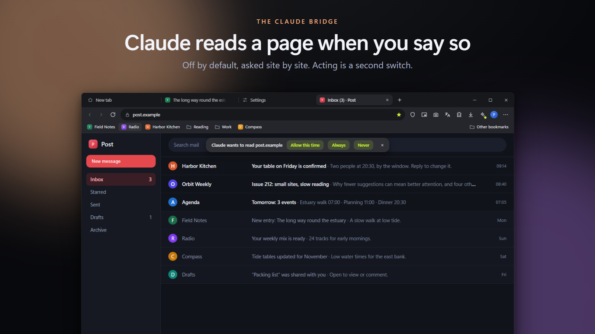
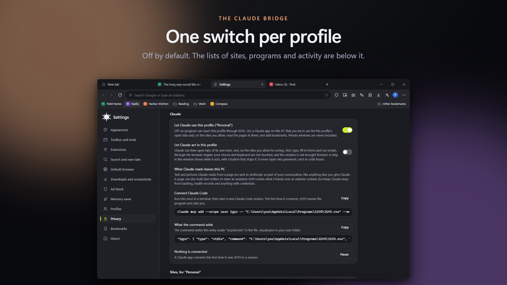

# The Claude bridge

IGYO can let a Claude app on the same PC use the browser: list your tabs, read a page's text, find
something in it, get its outline, take a picture of the tab on show, and add bookmarks. In a profile where
you also allow it, Claude can act as well: open tabs of its own, go to addresses, click, type, fill in
forms, run scripts, read the console and the network requests. Everything is off until you switch it on,
IGYO asks you before each new site is read, and asks again, apart, before Claude acts on a site.

This page says what is built, what you control, what it never does, and how it works inside.



## Switching it on

1. In IGYO: **Settings > Privacy > Claude > "Let Claude use this profile"**. The switch is per profile and
   off by default. It is never available in a private window.
2. For acting, also **"Let Claude act in this profile"**, below it. Off by default.
3. Tell the Claude app how to reach IGYO. Settings shows the line ready to copy; for Claude Code it is:

   ```
   claude mcp add --scope user igyo -- "<IGYO folder>\IGYO.exe" --mcp
   ```

   Settings also shows the same thing as an entry for a settings file
   (`{ "type": "stdio", "command": "<IGYO folder>\\IGYO.exe", "args": ["--mcp"] }`).

Nothing else is installed and no port is opened.



## What you see and control

- **The program is named first.** The first time a program connects, IGYO asks in the window, naming it (for
  example `claude.exe`), with **Allow this time**, **Always** and **Refuse**. "Always" remembers that
  program file; the list is in Settings, where you can remove it.
- **Each site is asked about.** The first time a site is wanted, IGYO asks "Claude wants to read
  *site*", with **Allow this time**, **Always** and **Never**. A site is a scheme plus a host
  (`https://mail.example.com`); another host, or `http` instead of `https`, is another site.
  "Allow this time" covers that tab for as long as it stays on that site. The request waits up to 90
  seconds for your answer; unanswered, Claude is told you have not answered.
- **Acting is asked about apart.** The first time Claude wants to act on a site, IGYO asks "Claude wants
  to act on *site*", with **Allow this time**, **Always** and **Decline**. Acting includes reading, so a
  site allowed for acting is also allowed for reading. Giving a page a file from the PC, or a picture
  Claude took, is asked about every time, naming the files and the site.
- **The questions are IGYO's, not the page's.** They stand in the bottom left corner of the page, in a small
  window of IGYO's own over the browser window, so a page can neither draw one nor press one; resting the
  pointer on a question shows what it means. A press in the first moment after a question appears does not
  answer it. A question in a window you are not using makes its taskbar button flash; the window does not
  come forward.
- **While Claude acts in a window**, a sign in that same corner says so ("Claude is working in this
  window."), with **Stop Claude**: that cuts every connection at once (the same as Pause). The tabs Claude
  opened are marked in the tab strip (a dashed ring around their icon).
- **Left out of recordings.** That corner window (questions, the sign, notices about Claude) is left out of
  every picture taken of the screen: screen recorders such as OBS, screenshots, screen sharing (Windows 10
  2004 or later). The person at the PC sees it; a recording of Claude at work does not.
- **A mark on the toolbar** shows while the switch is on for the profile, and the tab being read is marked
  while it is read. The mark's menu shows what is connected, what the site in the current tab is set to
  (Ask before reading, Always allow reading, Always allow reading and acting, Never allow), **Pause:
  disconnect now**, and a link to the lists in Settings.
- **Settings > Privacy > Claude** has the lists: sites with their setting, programs let in, and the
  activity (the last 500 requests: time, profile, tool, site and a few words such as "read 12,400
  characters" or "typed text"; never what was read or typed).

## The tools Claude gets

Reading (any profile with the first switch on):

| Tool | What it returns |
|---|---|
| `tabs_list` | The open tabs of the profiles that have the switch on, each with a reference to pass to the other tools. Title and address only for sites you allowed; for any other site just the site's name. Claude's own tabs are marked. |
| `page_text` | The text of a page as you see it: not the HTML, not what is typed in boxes, not frames embedded in the page. At most about 30,000 characters per call; a longer page is read on with the offset the answer names. |
| `page_outline` | Headings, links (text and address), buttons and form boxes (their kinds and labels, never their contents). |
| `page_find` | Where a word or phrase is in the page's text, each place with a little text around it and the offset to read on from. |
| `page_screenshot` | A picture of the tab on show: what is visible in the window, not the whole page. Frames from other sites and boxes for passwords, card numbers and one-time codes are covered in the picture. |
| `bookmarks_list` | A profile's bookmark folders (id, path, how much each holds), or the bookmarks in one folder. |
| `bookmark_add` | Adds a bookmark at the end of a folder of a profile, through the same bookmarks the windows show: the bar and the bookmarks page follow at once, and the file is written as for any change. An address already in that folder is not added twice. The window says so ("… added the bookmark …"). |

Acting (only in a profile with "Let Claude act" on; named as in Claude in Chrome where they do the same):

| Tool | What it does |
|---|---|
| `list_connected_browsers`, `select_browser`, `switch_browser` | IGYO's windows Claude may use (one per profile window), choosing one, or asking you to click "Use this window" in the one you want. |
| `tabs_create`, `tabs_close` | Opens a tab of Claude's own, at the end of a window of the profile named (or the chosen window), put on show there without bringing the window forward. Closes only Claude's own tabs; the window never closes because of it. |
| `navigate` | Goes to an http or https address, or back or forward. In a tab you opened, it needs leave to act on the site the tab is on. Never IGYO's own pages, local files or special pages. |
| `read_page`, `find` | The page's elements with references (`ref_12`) to act on: by default what can be acted on, with the current values of boxes (never of password, card or code boxes); `find` gives the best matches for a few words. |
| `computer` | Mouse, keys and pictures in a page: screenshot, zoom, clicks (left, right, double, triple, middle), hover, drag, scroll, scroll to an element, typing, keys and shortcuts, wait. Points are in the pixels of the last screenshot. |
| `form_input` | Sets a box, a list or a checkbox by its reference, so that the page's own scripts see it as typed or chosen. |
| `javascript_tool` | Runs a script in the page itself and gives the value of its last expression. |
| `read_console_messages`, `read_network_requests` | The page's console messages and its requests (time, method, status, kind, address; never contents) since IGYO started following the tab for Claude: from `tabs_create` (from the page's very first request), or from the first time Claude acted in it. |
| `resize_window` | Resizes the window (a maximized one is set back to normal first), kept inside the screen, without bringing it forward. |
| `file_upload`, `upload_image` | Puts files from the PC, or a picture Claude took, into a page's file box (or drops the picture). Asked about every time. |
| `gif_creator` | Records what Claude does in a tab (a frame after each action, with a ring where it clicked) and saves it as an animated GIF in your screenshot folder. |
| `browser_batch` | Several of these in one call, stopping at the first that fails. |

`tab` is optional for the reading tools (the tab in front is meant); the acting tools need it.

## What it never does

- Never a private window, never IGYO's own pages (the interface, Settings, the New Tab page), never a
  page that is not `http` or `https`, never a profile that does not have the switch on; acting never in a
  profile without the second switch.
- Never an unloaded tab of yours (one whose memory was released); a sleeping tab is woken to be read.
- Never the contents of a password box, a card-number box or a one-time-code box, in text, outline or
  picture; never typing or filling in such a box, nor typing into a frame from another site (IGYO can't
  see what kind of box is there).
- Never the PC's own mouse or keyboard: mouse and keys are given to the page through the engine. Never a
  window brought forward, never a window closed, never one of your tabs closed.
- No cookies, saved passwords, history, downloads, clipboard or IGYO settings.
- No picture of a tab that is not being shown, or of a minimized window.

## What it cannot protect you from

- **What Claude reads leaves the PC.** Text and pictures returned to a Claude app become part of that
  conversation with Anthropic's service.
- **What Claude does in a page is done as you.** On a site allowed for acting, Claude clicks and types with
  your sign-in on that site. Allow acting only where you would let someone else use your account, and keep it
  off for profiles where you bank or handle credentials.
- **Instructions hidden in pages.** A page can contain text written to steer an assistant. IGYO marks
  everything that comes from a website as website content (see below), but cannot make that risk zero.
- **Other programs running as you.** With the switch on, a program running under your Windows account can
  try to connect. That is why IGYO names each program and asks.

## How it works

```
Claude app ──starts──▶ IGYO.exe --mcp ──named pipe, this Windows user only──▶ IGYO (the window you see)
                       speaks MCP on its                                       is the switch on for this profile?
                       standard input/output                                   is this program allowed? this site?
                       and keeps no state                                      then the engine reads or acts in the tab
```

- **The relay** is the same `IGYO.exe` started with `--mcp`. It opens no window and does not touch
  IGYO's data folder. It speaks the Model Context Protocol over standard input and output, one JSON
  message per line, in both forms of the protocol: with the `initialize` handshake (versions 2025-11-25,
  2025-06-18, 2025-03-26, 2024-11-05) and without one (2026-07-28, where each request names its version
  and `server/discover` describes the server).
- **The pipe** is named `IGYO.Bridge.<key>.<process id>`, where the key is 12 hex digits of the SHA-256
  of the data folder's path. Its access list allows the current Windows user and denies network logons.
  It exists only while at least one profile has the switch on. Messages are newline-delimited JSON; a
  request may be at most 1 MB and an answer 16 MB.
- **Each side checks the other.** The relay connects only to a pipe owned by the same Windows user whose
  server process is the same `IGYO.exe` file as itself. The browser looks up which program is at the
  other end of the pipe (for the relay, the program that started it) and asks you about that program.
  A client that connects and says nothing is dropped after 15 seconds.
- **The browser decides.** Every request is checked inside IGYO against the profile's switches, the
  program list and the site list. The relay and Claude cannot widen any of them.
- **Reading** is done through the engine's debugging protocol on that tab only, in a separate script world
  that the page's own scripts cannot reach or change. The address is read in the same step as the content
  and compared with the site you allowed, so a page that moves to another site between the question and the
  read is not read.
- **Acting** goes through the same protocol: mouse and key events, typed text and file boxes are given to
  that tab's page by the engine (`Input.*`, `DOM.setFileInputFiles`), not by Windows. Element references live
  in a world of IGYO's own in the page, apart from the page's scripts, until the page changes. Only
  `javascript_tool` runs Claude's script in the page's own world. While some profile lets Claude act, the
  engine is started so that it keeps drawing windows other windows cover (otherwise it stops, and a covered
  window could not be pictured); that holds from the next start after acting is switched on.
- **Answers** put website content between two marker lines that carry a random code chosen for that
  answer, with IGYO's own lines (`[IGYO] …`) outside them, so text inside a page cannot pass for
  IGYO's part of the answer. Titles are cut to one line.
- **Several copies of IGYO** can run; each has its own pipe. `tabs_list` merges them, and a tab's
  reference says which copy it belongs to.
- **Sizes**: text answers stop at 30,000 characters and at about 9,000 tokens by estimate; pictures are
  JPEG, at most 1568 pixels on the long side and about 1.15 megapixels.

The code: `McpRelay.cs` (relay and protocol), `Bridge.cs` (the browser's side), `Bridge.Act.cs` (acting,
bookmarks), `BridgeAgent.cs` (the acting scripts, mouse and keys, recordings), `BridgePipe.cs` (pipe, access
list, process checks), `BridgeStore.cs` (the lists), `BridgeTools.cs` (the reading itself),
`MainForm.Bridge.cs` (bars, toolbar mark, menu, Claude's tabs).

## How it was tested

Against the Debug build on a throwaway data folder, on a Windows desktop that is never shown, with pages
served from the same PC and every other name lookup failing. A script played the Claude app's part by
starting the relay and speaking MCP to it.

Reading (125 checks in the scripts, plus 43 in `IGYO.exe --selftest`): the switch off and on; the program
question (answered, not answered, remembered across a restart); the site question in each of its answers
and closed without one; leaving a site ends "this time"; a long page read in parts; find; outline without
box contents; pictures with the covers in place; a hostile page that tries to answer IGYO's question, forge
the reading functions, fake the end marker or break the header with a multi-line title; IGYO's own pages
refused; a private window's tabs unreachable; four requests at once; a wrong protocol version; cancelling;
pause and resume; a client that skips the greeting; a sleeping tab woken; an unloaded tab refused; the
activity list holding no content.

Acting (49 checks), with two profile windows open, one where Claude may act and one where it may only read:
the tool list; the program question; the windows listed with what each allows; a tab refused in the
reading-only profile; Claude's tab opened in the other, marked, with the strip shown naming the program;
the act question and "Allow this time"; a picture with its scale; read_page with references and a password
box shown as one without its value; find; filling in a box, a list and a checkbox; the password box refused
by form_input and by typing (nothing typed into it); typing two lines; Ctrl+A and Backspace; a click at
picture coordinates and a double click; the form sent with what was filled in; a script's value; the
console (all, and errors only); the page's own request in the network list (from its first request); zoom;
a batch of four; a picture and a file given to a file box (asked; given and refused); a recording saved as
an animated GIF; going to another site without a question in Claude's own tab, then the act question
declined there; back; IGYO's pages and local files refused; resizing; bookmark folders listed; a bookmark
added to a folder at once on the bar and in that profile's file, the other profile's file untouched, the
same address not added twice; the bookmarks file changed by another program while IGYO runs and shown at
once, and kept by IGYO's next change; Claude's tab closed with the window staying; one of the person's
tabs refused; no window activated by any of it; Stop on the strip cutting Claude off. And: the engine
started to keep drawing covered windows exactly when some profile lets Claude act.

With Claude Code 2.1.325, `claude mcp add` wrote the entry and `claude mcp list` showed the server as
connected.

**Not tested:** a tool call made from inside a real Claude conversation, and the Claude desktop app;
Claude picturing a window that another window covers on a real screen (on the desktop that is never shown,
pictures worked whether or not the engine was asked to keep drawing covered windows); `switch_browser`
answered by a person.

## Not built

- A package for the Claude desktop app's chat.
- Loading Anthropic's Chrome extension itself.
